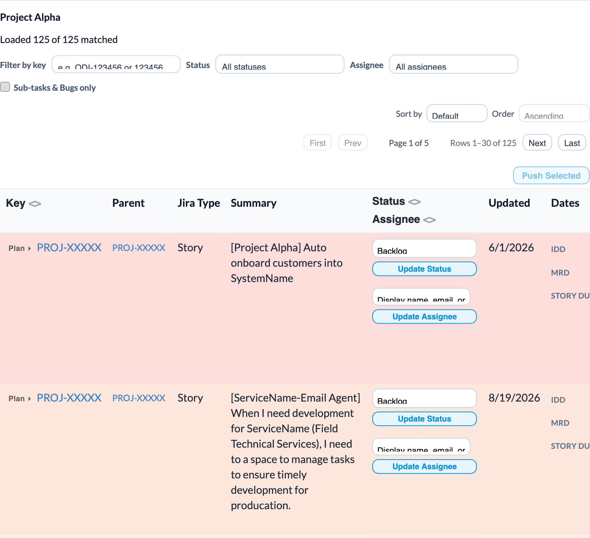
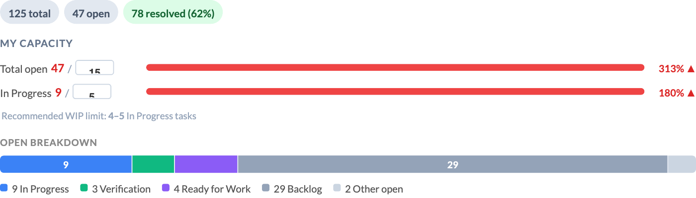
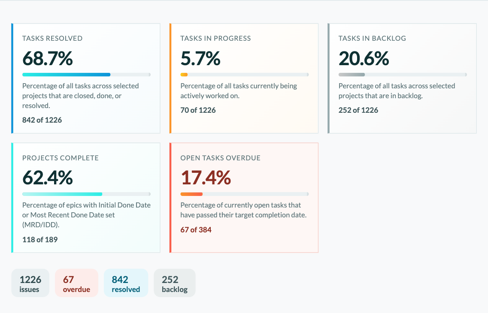
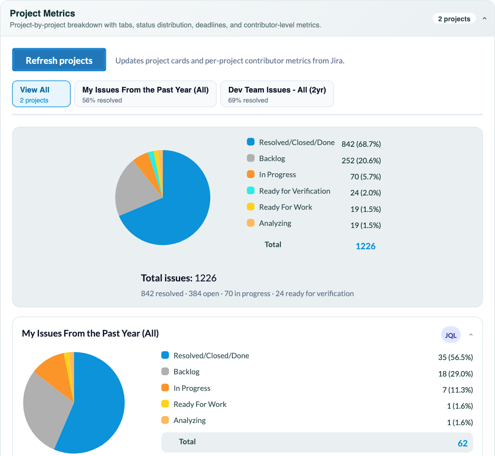
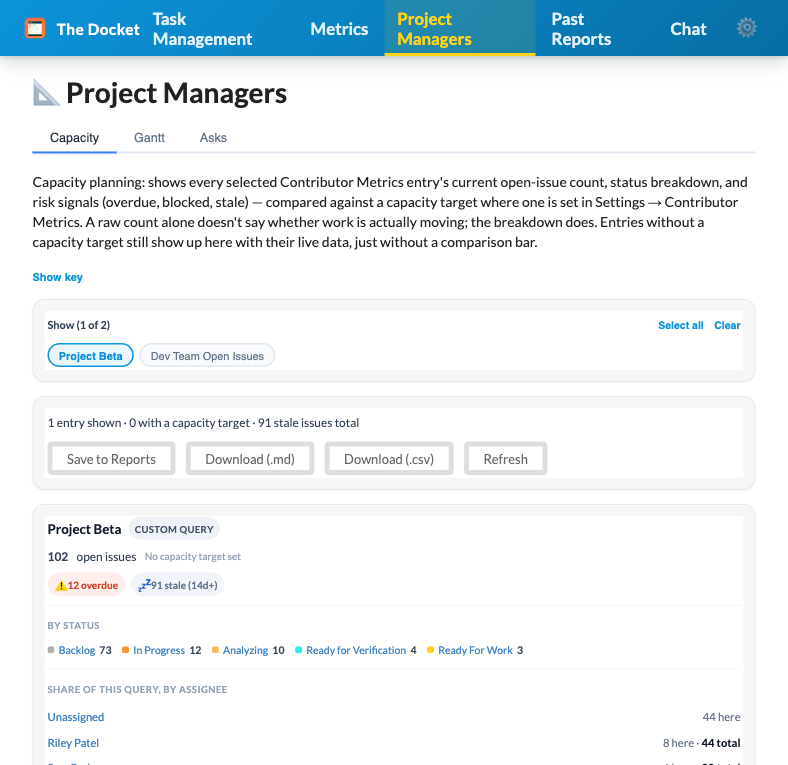
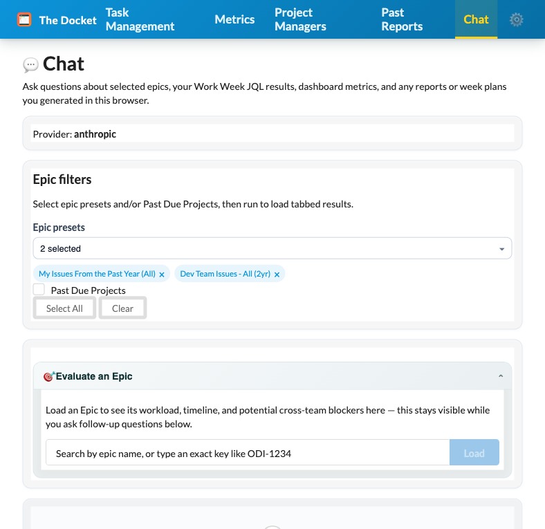
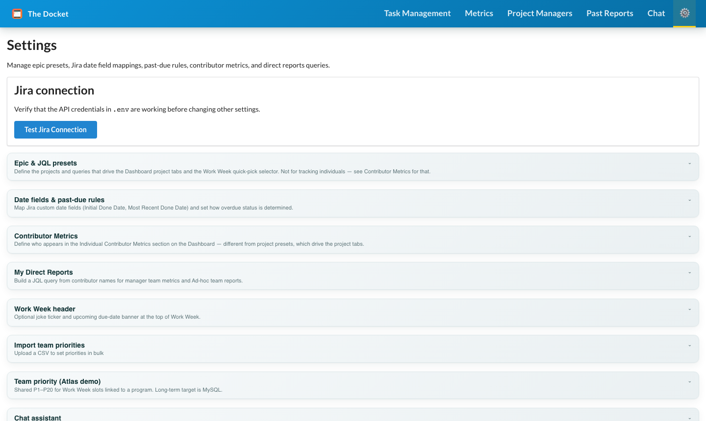

# The Docket

> A desktop and browser app for Jira-powered teams — daily task management, PM capacity planning, and AI-generated reports in one local workspace.

---

## Screenshots

**Task Management — daily JQL runs with inline status updates, priorities, and notes**


**My Metrics — IC capacity tracking with WIP limit and open-issue breakdown by status**


**Metrics — overall project health at a glance**


**Metrics — per-project breakdown with status distribution charts**


**Project Managers — capacity planning with contributor workload by status**


**Chat — natural-language Jira questions backed by loaded data**


**Settings — Jira connection, presets, date fields, and contributor configuration**


---

## Overview

The Docket connects to your Jira project through a local Express proxy. Credentials stay in your local `.env` file; no third-party cloud service receives them.

---

## App tabs

| Tab | Use it for | Key outputs |
|-----|------------|-------------|
| Task Management | Daily JQL runs, issue edits, notes, priorities, create issue | Per-query metrics, project reports, week plans |
| Metrics | Project and contributor health across saved epics/JQL presets | Metrics snapshot, audience reports, weekly digest |
| Project Managers | Capacity planning from Contributor Metrics entries | Capacity cards, `.md` / `.csv` exports, saved reports |
| Past Reports | Archived generated outputs and saved Chat replies | View, copy, download, or delete local report records |
| Chat | Natural-language Jira questions with app session context | Jira-backed answers, optional save to Past Reports |
| Settings | Jira setup, presets, field mappings, report/chat preferences | Shared preset packs and connection checks |

**Task Management** is the daily driver. Run up to five saved JQL queries, update status or assignee, set P1–P20 priority, write notes, push notes to Jira, attach screenshots and recordings, create issues, and generate AI reports or week plans from the loaded work.

**Metrics** is the project view. Pick saved Epic/JQL presets, refresh a Jira snapshot, review overall/project/contributor metrics, inspect due-date lists, and generate leadership or team-facing reports.

**Project Managers** turns Contributor Metrics entries into a capacity view. It compares open issue counts against optional capacity targets, highlights overdue/blocked/stale work, and exports planning summaries.

**Past Reports** is the local archive for generated Task Management reports, week plans, Metrics reports, and Chat replies saved with **Save to Past Reports**.

**Chat** answers Jira questions using selected presets, recent Task Management JQL results, the latest Metrics snapshot, and generated reports/plans already in the session. Chat works with Anthropic, OpenAI-compatible providers, Ollama, or opt-in Rovo.

**Settings** is where you configure Jira credentials checks, Epic/JQL presets, Jira date-field mappings, past-due rules, Contributor Metrics entries, Work Week header preferences, and custom Chat instructions.

---

## Who it's for

The Docket is built for **engineers and project managers** who work in Jira daily and want a faster, smarter alternative to juggling raw Jira views, spreadsheets, and status-update emails.

**Primary use cases:**
- Engineers who need a focused daily view of their assigned work across multiple queries
- PMs and leads who track project health across several epics at once
- Anyone who writes weekly status updates and wants them generated from real data
- Team leads monitoring individual contributor workloads and deadlines

---

## Quick start

Works on **macOS and Windows** (and Linux for browser dev).

**macOS / Linux (Terminal):**
```bash
# 1. Use the pinned Node version (once per new shell)
nvm install
nvm use

# 2. Install dependencies (once)
npm install

# 3. Copy and fill in credentials (once)
cp .env.example .env
# → edit .env with your JIRA_BASE_URL, JIRA_EMAIL, JIRA_API_TOKEN

# 4. Start (pick one)
npm run dev:all        # browser at http://localhost:5173
npm run desktop:dev    # Electron desktop window
```

**Windows (PowerShell):**
```powershell
# 1. Node 22 required — install from nodejs.org or nvm-windows, then verify:
node -v

# 2. Install dependencies
npm install

# 3. Copy credentials template
Copy-Item .env.example .env
# → edit .env with Notepad or your editor

# 4. Start (pick one)
npm run dev:all
npm run desktop:dev
```

Some corporate secure laptops may block Electron windows, local desktop apps, or the embedded proxy. If `npm run desktop:dev` is unavailable, run `npm run dev:all` and install the browser UI as its own desktop-style app window; see [END_USER_GUIDE.md](./docs/END_USER_GUIDE.md#install-as-its-own-application-window).

Packaged installers, including unsigned Mac `.dmg` and Windows NSIS installers, are unsupported. Both supported launch workflows require the project checkout, Node, installed dependencies, and the local `.env` setup above. `npm run build` builds the browser assets; `npm run desktop:build` remains an alias for that build.

### Native SQLite recovery

Installation rebuilds `better-sqlite3` for Node. `npm run dev:all` rebuilds it for the browser API, while `npm run desktop:dev` rebuilds it for Electron before launching. These runtimes use different native ABIs, so stop the current workflow before switching.

If a native-module version error persists, run `npm rebuild better-sqlite3` before `npm run dev:all`, or `npm run desktop:rebuild-native` before `npm run desktop:dev`. `npm run desktop:doctor` combines the Electron rebuild and desktop launch. `npm test` also rebuilds for Node; restart the desktop workflow afterward if switching back to Electron.

### Local API security and Jira configuration

The API listens only on `127.0.0.1` (`API_PORT`, default `8787`). Keep using `npm run dev:all` or `npm run desktop:dev`; Vite forwards `/api` to the IPv4 loopback API. Requests must have a loopback Host with the actual API port. Forwarded host headers do not grant access.

The default allowed browser origins are exactly `http://localhost:5173`, `http://127.0.0.1:5173`, and `http://localhost:<API_PORT>` / `http://127.0.0.1:<API_PORT>`. Other origins, including `null`, are rejected before any API handler runs. Add explicit origins using comma-separated `DOCKET_ALLOWED_ORIGINS` in the local server environment. Use complete origins with no path or trailing slash; do not add `null` or untrusted origins.

Origin-free requests with a valid Host are permitted for trusted local processes. App-session authentication is deferred: this protects the browser boundary and limits network exposure, but other processes running as the same user can call the API or read local files. It does not provide isolation from those processes.

Jira destinations must use HTTPS, port 443, no user information, and an exact approved hostname. Pasted `/browse/...` links become the site origin. The seven default hosts are `lumen.atlassian.net`, `lumen-nm.atlassian.net`, `lumen-vyvx.atlassian.net`, `lumen-bll.atlassian.net`, `lumen-sre.atlassian.net`, `lumengss.atlassian.net`, and `lumen-bira.atlassian.net`. Add explicitly trusted hostnames with comma-separated `JIRA_ALLOWED_HOSTS` (hostnames only, without scheme, path, or port). Jira credential requests do not follow redirects. Attachment media lookups read only the redirect Location and discard the body; they never send credentials to the media destination.

Every Jira request has a 30-second deadline covering the response body as well as the connection. Set a positive integer `JIRA_REQUEST_TIMEOUT_MS` in the local server environment to change it. Timeouts return HTTP 504 with `JIRA_TIMEOUT` and an outcome of `not-written` for reads (including search POSTs) or `unknown` for writes. Writes are never automatically retried. Keep your edits and check Jira before submitting again: an interrupted write may already have succeeded. Other provider traffic keeps its existing timeout behavior.

Set the personal Jira token using `JIRA_API_TOKEN` in the server `.env` and restart after changes. Settings stores each site's URL and email, and never accepts or returns tokens. `JIRA_BASE_URL`, `JIRA_EMAIL`, and `JIRA_INSTANCE_1_NAME` remain supported, as do `JIRA_INSTANCE_1_BASE_URL` / `JIRA_INSTANCE_1_EMAIL` / `JIRA_INSTANCE_1_NAME` through instance 5. Numbered `JIRA_INSTANCE_n_API_TOKEN` values are ignored; all sites use `JIRA_API_TOKEN` with their own saved email.

Previously saved token columns are transitional recovery data only and are never used for Jira calls. To retire a saved token, set `JIRA_API_TOKEN`, restart, then use **Settings → Jira sites → Edit → Test connection** with the saved site's URL and email. Only a successful verification of those saved settings clears that site's old token. Missing or invalid environment credentials, failed checks, and tests of changed unsaved settings preserve it.

Electron runs its renderer in a sandbox with context isolation and no Node integration. Main-window navigation stays on the exact app origin, and renderer-created windows are denied. Approved Jira HTTPS links open in the system browser, using the same `JIRA_ALLOWED_HOSTS` configuration as the server. Atlassian sign-in opens only `auth.atlassian.com`; its redirects run in the system browser. Other trusted report/note link destinations require explicit comma-separated `DOCKET_EXTERNAL_HOSTS` hostnames in the local environment, followed by a restart. User information, non-HTTPS schemes, alternate ports, subdomain lookalikes, and arbitrary destinations are blocked. Attachment previews stay inside the app; downloads remain available for file types the preview cannot display.

Application and Vite responses carry a Content Security Policy. Production scripts come from the app itself. Development permits only the exact hashed React refresh preamble, the local Vite HMR socket at port 5173, and the actual local API port. Semantic UI and existing inline styles require `style-src 'unsafe-inline'`; fonts use only `fonts.googleapis.com` and `fonts.gstatic.com`. Images permit the app, blobs and data URLs; development also permits the local API image endpoint. The existing joke ticker connects only to `icanhazdadjoke.com` and `v2.jokeapi.dev`. AI and Rovo API calls remain server-side, so they receive no renderer script or connection allowance. CSP blocks plugins/objects, base URL injection, and embedding the app in another page.

Full setup details → **[JIRA_SETUP.md](./docs/JIRA_SETUP.md)**
Code architecture → **[DEVELOPER_GUIDE.md](./docs/DEVELOPER_GUIDE.md)**
Day-to-day usage → **[END_USER_GUIDE.md](./docs/END_USER_GUIDE.md)**

---

## Optional shared team data (PostgreSQL)

Local SQLite works without a team database. A company database is neither provisioned nor needed for local use. To enable shared data, have the database owner provide an approved PostgreSQL database and set server-only `TEAM_PRIORITY_DATABASE_URL` (explicit user, hostname and database). Optionally set `TEAM_PRIORITY_DATABASE_CA_FILE` to an absolute PEM trust-file path. Keep credentials out of browser settings, source control and exported files.

Remote connections always verify TLS against the system trust roots or the supplied CA. Remove SSL options from the URL when providing a CA; conflicting URL options are rejected. URLs may contain only `sslmode=verify-full`, or `sslmode=disable` for explicit loopback development/test hosts. TLS-free access is allowed only for `localhost`, `127.0.0.1` or `::1` outside production. Production requires verified TLS even on loopback. The pool opens lazily, has at most five connections, a five-second connect timeout and a thirty-second statement timeout.

With that server environment exported, run:

```sh
npm run team-db:migrate
npm run dev:all
```

The migration CLI reads the exported environment; it does not read `.env`. The API also supports its normal server `.env`. Migrations run only when explicitly requested. Version records in `team_schema_versions` and a transaction-level migration lock make repeated/concurrent runs safe. A failed migration rolls back; correct the reported setup problem and rerun. Before an upgrade, use your approved database backup process; restore that backup into a separate database for recovery. Do not edit an applied migration or drop shared tables as a recovery shortcut.

Settings → **Team data** shows configured/connected status. An absent schema is unavailable with `npm run team-db:migrate` guidance, rather than an empty shared-data result. Individual priority/date edits and explicit priority push/pull remain available. Settings → **Import metadata** opens an editable CSV preview: fix values, exclude rows, add/remove supported columns, and review old/new values before **Approve changes**. **Save locally** and **Save to team** are equally primary choices for priority, note, Now/Next, requestor, planned start/finish, actual start and decision note. Team saving requires a configured, connected database and never falls back to local saving. Changing the destination reads that destination's values and requires fresh approval. Existing notes are protected unless replacement is checked for that row. Empty CSV cells preserve saved values; clearing an edited field is explicit. Importing never changes Jira or note images. Re-run your task query after saving.

`POST /api/jira/issue-metadata/import/preview` accepts `{destination:'local'|'team',csvText?,rows?,supersedesPreviewId?}` with exactly one input. Edited rows are `{rowId,issueKey,selected,patch,replaceNote}`. Responses contain `previewId,siteContext,destination,rows,diff,errors,ignoredHeaders,expiresAt`; diff includes supported saved values and approved old/new changes. `supersedesPreviewId` replaces only an uncommitted, unexpired preview bound to the same accepted site context; invalid replacement retains the old preview. Five live previews can wait for at most 15 minutes. Approval alone writes nothing; `POST /api/jira/issue-metadata/import/commit` accepts only the reviewed `previewId` for saving. Authoritative patches/expected values remain private on the server. Conflicts reject the whole batch and require a new preview; site switching or API restart also requires re-review. Up to five successful results are retained separately for 60 seconds for duplicate-submit confirmation. A network failure has an unknown outcome: retry the same save before starting another destination. The obsolete `/api/jira/issue-metadata/import` and `/api/team-priority/import-csv` mutation endpoints return 409 `IMPORT_PREVIEW_REQUIRED` with Settings guidance. Full team reads remain at `POST /api/team-priority/metadata/bulk`.

Shared identity is the accepted server Jira hostname plus issue key. The browser never selects a hostname through a payload. Priority zero clears only priority. Clearing date tracking clears start/complete/planned dates and PM override, preserving notes, follow-up, requestor, open-decision information, pin and priority. SQL DATE values cross the store boundary as `YYYY-MM-DD` strings or null; legacy date reads retain empty-string clears. Note images and local image paths are not stored in team rows. Compatibility date reads include only explicitly shared tracking records, so shared priority alone does not override personal planning inheritance. Explicit false/empty tracking writes retain shared presence. Deliberate date-tracking deletion removes that presence when requestor/open-decision note are empty and the decision flag is false; retained requestor/decision data keeps it. The internal marker is not returned as metadata. Older consolidated false-only/cleared rows lack recoverable provenance: the migration backfills meaningful nondefaults only, and intentionally shared empty records need manual re-saving. Shared programs retain source-qualified epic roots and are returned only for the accepted site; there are no built-in seed programs.

### Explicit migration of old demo exports

There is no automatic MongoDB/Atlas connection or startup migration. Preserve the original JSON exports unchanged. Prepare a separate annotated JSON copy containing the old collection arrays below, with a `source` identifier on every issue row. Old issue keys alone do not establish a Jira site. Convert each program epic string into an explicit `{ "source": "old-demo-a", "issueKey": "ABC-1" }` reference using verified source knowledge; do not guess. Supply a separate source-to-canonical-hostname mapping file. Missing or unknown source mappings and unknown collections fail before a transaction opens.

`annotated-demo.json` (synthetic example):

```json
{
  "team_issue_priorities": [
    { "_id": "ABC-1", "source": "old-demo-a", "priority": 4 }
  ],
  "team_issue_dates": [
    { "_id": "ABC-1", "source": "old-demo-a", "startDate": "2026-10-01", "plannedFinish": "2026-10-05", "requestor": "Synthetic requestor" }
  ],
  "shared_programs": [
    { "slug": "synthetic", "displayName": "Synthetic", "enabled": true,
      "epicRoots": [{ "source": "old-demo-a", "issueKey": "ABC-1" }] }
  ]
}
```

`site-map.json`:

```json
{ "old-demo-a": "jira.example.test" }
```

```sh
npm run team-db:import-demo -- annotated-demo.json site-map.json
```

Issue records accept `_id` or `issueKey`. Date records preserve the existing `startDate`, `completeDate`, `hasOpenDecision`, `plannedStart`, `plannedFinish`, `pmOverride`, `requestor`, and `openDecisionNote` fields. Export-only IDs/audit fields are not imported; writes are attributed to `explicit-demo-migration`. Program display/enabled settings are upserted and explicitly mapped roots are merged. All collections commit together or roll back together, and input files are read only. Repeating the same import does not duplicate program roots. Review the annotated copy and mapping before running; this explicit command writes team data immediately.

### Team database validation

```sh
node --test tests/teamPriorityPostgres.test.mjs tests/teamPriorityRoutes.test.mjs
DOCKET_TEST_DATABASE_URL=postgresql://docket_test@127.0.0.1:55432/docket_test_application_review node --test tests/teamPriorityPostgres.test.mjs tests/teamPriorityRoutes.test.mjs
```

The first command skips SQL integration cases. The second requires your own disposable `docket_test_*` database, explicit loopback host/port and PostgreSQL server; it must never target a company or personal database. Tests verify real SQL site isolation, fields, clears, conflicts, migrations and rollback. CI's PostgreSQL 16 job must set the URL and reject skipped integration cases. Local PostgreSQL 14.1 fixture evidence does not establish production/CI compatibility. Company SonarQube remains a required pre-merge gate; no Ruff substitution applies to this JavaScript code.

## Excel task export API

The local API creates a reviewed, server-held snapshot with `POST /api/task-export/preview`, then downloads an actual Excel workbook with `POST /api/task-export/download`. Download accepts only `{previewId, excludedRows, allowPartial}`. Exclusions use all three fields `{instanceId, siteHost, issueKey}` from that preview. Partial or failed entries require explicit `allowPartial: true`; invalid or expired preview IDs return HTTP 409 and require a new preview. Preview storage lasts fifteen minutes, supports three live/in-flight previews and at most 25 MiB of serialized snapshots. Downloads read the captured snapshot without fetching Jira or databases again.

Each selected saved Jira entry gets its own worksheet, including entries sharing a hostname and issue key. Overview maps saved IDs, labels and full hostnames to worksheet names, and records scopes, filters, metadata source, counts and omissions. Empty and failed entries remain visible. Sheets include **Latest Jira comment only**, with its author, supplied timestamp and availability status, plus separate **Docket local notes** and **Team notes**. Local selection leaves Team notes blank and marks them not selected. Unavailable comments or local notes stay visibly unavailable; no note-source fallback occurs.

Notes and formula-looking text remain literal strings. Date-only planning fields keep their exact `YYYY-MM-DD` strings. Jira hyperlinks derive from the snapshot's validated hostname and issue key. The writer rejects cells over 32,767 characters or containing invalid XML characters, identifying the saved entry, issue and column so an affected task can be excluded. It rejects workbooks exceeding 25 MiB without truncating data. ExcelJS 4.4.0 is pinned with a narrowly scoped uuid 11.1.1 override; neither dependency runs in the browser. Disconnects discard the response, and snapshot expiration is checked again before sending. Library writing may finish after cancellation; crash recovery is not provided.

Collection is sequential with the existing Jira request timeout plus `DOCKET_EXPORT_TIMEOUT_MS` (default 120000 ms, positive integer capped at 600000 ms). `DOCKET_EXPORT_MAX_ROWS_PER_SITE` defaults to and is capped at 5000 tasks per saved entry. Reaching a limit without verified completion marks the entry partial. These are server environment settings; no export operation migrates a source database or uploads the workbook.

## Data & privacy

| What | Where stored | Leaves your machine? |
|------|-------------|----------------------|
| JQL text, labels, last table snapshot | Browser `localStorage` | No |
| Task Management drill-down tabs | Browser `sessionStorage` | No |
| Chat session artifacts (reports/plans for context) | Browser `localStorage` | No |
| On-page reports/plans (Task Management + Metrics) | Browser `localStorage` | No |
| **Past Reports** archive | `data/workweek.sqlite` → `generated_reports` | No |
| Personal To Dos + completed history | `data/personal-todos.sqlite` (local file) | No |
| Per-issue notes + P1–P20 priority | `data/workweek.sqlite` (local file) | No for personal slots |
| Start date (ad-hoc, for Gantt views) | `data/workweek.sqlite` (local file) | No for personal slots |
| Status/assignee changes | Jira (your Atlassian instance) | Yes — visible in Jira to anyone with access |
| Due date / MRD changes | Jira (your Atlassian instance) | Yes |
| Notes you push as comments | Jira (your Atlassian instance) | Yes — text and attachments, rendered as markdown |
| Metrics snapshot | `data/workweek.sqlite` | No |
| Jira credentials | `.env` file on this machine | No — only the local proxy reads them |
| Chat message content | Your configured LLM provider (Anthropic/OpenAI/etc.) when you send a message | Yes — to that provider's API |

---

Personal To Dos save automatically without a Jira connection and remain available across site switches, site deletion, and restarts. They are separate from team priorities. Existing records migrate without applying the 15-active-item creation limit; new items are allowed once fewer than 15 are active. Completed **All time** includes entries whose completion date is unknown.

Migration keeps source databases and a durable record ledger, so deleting a migrated item never recreates it. Historical seed flags cannot prove whether a legacy database was copied, and old reminder conversion left no ledger. Ambiguous records stay in the original local databases for recovery; the To Do response and completed history panel show a recovery notice with source IDs and counts. Other report archives remain scoped to the selected Jira site.

## Tech stack

- **Frontend**: React 18, Vite 8, Semantic UI React, React Router
- **Backend**: Express.js proxy (`server/`), better-sqlite3
- **Desktop**: Electron 43 (local development)
- **AI**: Anthropic / OpenAI / Ollama (configurable in `.env`)
- **Database**: SQLite at `data/workweek.sqlite` (auto-created on first run)

### Download a task workbook

In Task Management, choose **Download tasks**, select saved Jira entries, and choose projects or saved presets for each entry. Local metadata is the default; Team is an explicit per-entry choice and is disabled when the Team database is unavailable. Optional filters include completed work, Docket priority, and Now / Next. Each saved entry has its own worksheet, even when entries share a Jira hostname and issue keys. Export does not change the active entry.

Finish pending saves before previewing. If a save failed, retry it or explicitly choose to export saved values; unsaved edits are excluded. Review the snapshot time, entry completeness, and separate **Docket local notes**, **Team notes**, and **Latest Jira comment** columns. **Latest Jira comment only** means the most recently created comment visible to the selected Jira account, with author/date when available. Notes are text only; images and attachment files are excluded. Unavailable data is labeled, and partial or failed entries require explicit partial-download consent. Row exclusions apply to the saved entry, hostname, and issue key together.

Changes to selected entries, source, scope, or filters clear the preview. Retry preview collects a new snapshot; download uses the reviewed snapshot without refreshing sources. Previews expire after fifteen minutes. If a download fails, follow its guidance to retry, refresh the preview, narrow filters, or exclude an identified oversized row. Save the `.xlsx` file and share it manually through SharePoint. A workbook is a snapshot, not real-time synchronization; the application does not upload it to SharePoint.
