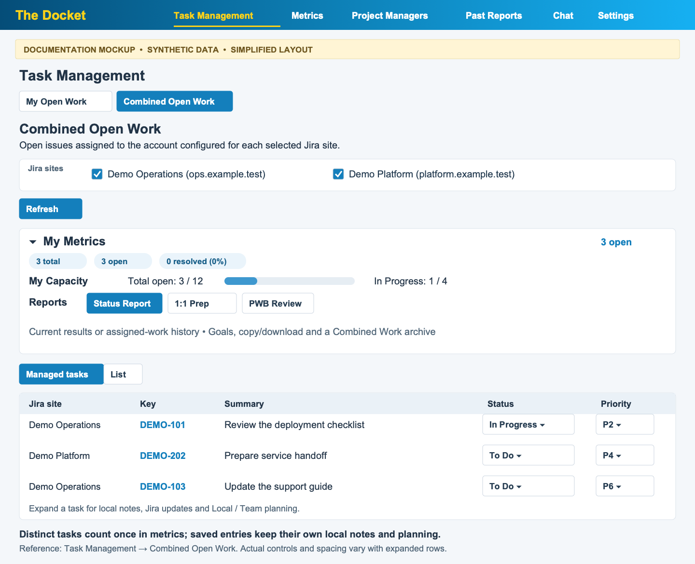

# The Docket

> A desktop and browser app for Jira-powered teams — daily task management, PM capacity planning, and AI-generated reports in one local workspace.

---

## Documentation

| I want to… | Read |
|---|---|
| Use the app day to day | [User guide](docs/END_USER_GUIDE.md) |
| Connect Jira, set presets and AI providers | [Jira setup](docs/JIRA_SETUP.md) |
| Understand or change the code | [Developer guide](docs/DEVELOPER_GUIDE.md) |
| Run the optional team database | [Team database guide](docs/TEAM_DATABASE.md) |
| See the screens | [Screenshots and mockups](docs/GALLERY.md) |


*Documentation mockup — synthetic data; simplified layout. More in the [gallery](docs/GALLERY.md).*

---

## Overview

The Docket connects to Jira through a local Express proxy. Work in one saved Jira site or collect assigned work across saved sites in **Combined Open Work**. Local notes, planning, personal To Dos, and report archives remain available without a company database. Shared team metadata uses optional PostgreSQL, enabled explicitly in Settings.

The server reads credentials from its environment and authenticates requests to Jira or the selected AI provider. AI chat and reports send their selected context to that provider; the browser does not receive the Jira API token.

---

## App tabs

| Tab | Use it for | Key outputs |
|-----|------------|-------------|
| Task Management | Daily JQL runs, Combined Open Work, issue edits, notes, priorities, personal To Dos | My Metrics, reports, week plans, task workbooks |
| Metrics | Project and contributor health across saved epics/JQL presets | Metrics snapshot, audience reports, weekly digest |
| Project Managers | Capacity planning from Contributor Metrics entries, Gantt timelines, and stakeholder Asks | Capacity cards, `.md` / `.csv` exports, saved reports, Asks CSV |
| Past Reports | Site archives, Combined Work reports, saved Chat replies, completed To Dos | View, copy, download, or delete local report records |
| Chat | Natural-language Jira questions with app session context | Jira-backed answers, optional save to Past Reports |
| Settings | Jira setup, presets, field mappings, report/chat preferences | Shared preset packs and connection checks |

**Task Management** is the daily driver. Use **Combined Open Work → Managed tasks** to edit assigned work across saved Jira entries, or **List** for a compact overview. My Metrics includes Status Report, 1:1 Prep, and PWB Review, with separate Combined Work goals and archive. Run up to five saved JQL queries, update status or assignee, set P1–P20 priority, write notes, push notes to Jira, attach screenshots and recordings, create issues, and generate AI reports or week plans from the loaded work.

**Metrics** is the project view. Pick saved Epic/JQL presets, refresh a Jira snapshot, review overall/project/contributor metrics, inspect due-date lists, and generate leadership or team-facing reports.

**Project Managers** turns Contributor Metrics entries into a capacity view. It compares open issue counts against optional capacity targets, highlights overdue/blocked/stale work, and exports planning summaries. The **Asks** tab tracks exec or product-owner requests: create a Jira task from an ask (it links the new key and marks the ask done), or mark it done or canceled.

**Week plans** cover only issues assigned to you, ranked by a transparent suggested-order score (priority, status, staleness, due date, blockers, your own P1–P20). **Create Issue** checks for possible existing issues before it creates or drafts, and titles under a bracketed parent follow `[Project - Area] short ask`. Generated reports follow fixed writing-style rules (exact figures, no vague verbs, no filler). Details are in the [end-user guide](docs/user/week-plan.md#help-me-plan-my-week).

**Past Reports** is the local archive for generated Task Management reports, week plans, Metrics reports, and Chat replies saved with **Save to Past Reports**.

**Chat** answers Jira questions using selected presets, recent Task Management JQL results, the latest Metrics snapshot, and generated reports/plans already in the session. Chat works with Anthropic, OpenAI-compatible providers, Ollama, or opt-in Rovo.

**Settings** is where you configure Jira credentials checks, Epic/JQL presets, Jira date-field mappings, past-due rules, Contributor Metrics entries, Work Week header preferences, and custom Chat instructions.

---

## Who it's for

The Docket is built for **engineers and project managers** who work in Jira daily and want a faster, smarter alternative to juggling raw Jira views, spreadsheets, and status-update emails.

**Primary use cases:**
- Engineers who need a focused daily view of their assigned work across multiple queries
- PMs and leads who track project health across several epics at once
- Anyone who writes weekly status updates and wants them generated from real data
- Team leads monitoring individual contributor workloads and deadlines

---

## Quick start

Works on **macOS and Windows** (and Linux for browser dev).

**macOS / Linux (Terminal):**
```bash
# 1. Use the pinned Node version (once per new shell)
nvm install
nvm use

# 2. Install dependencies (once)
npm install

# 3. Copy and fill in credentials (once)
cp .env.example .env
# → edit .env with your JIRA_BASE_URL, JIRA_EMAIL, JIRA_API_TOKEN

# 4. Start (pick one)
npm run dev:all        # browser at http://localhost:5173
npm run desktop:dev    # Electron desktop window
```

**Windows (PowerShell):**
```powershell
# 1. Node 22 required — install from nodejs.org or nvm-windows, then verify:
node -v

# 2. Install dependencies
npm install

# 3. Copy credentials template
Copy-Item .env.example .env
# → edit .env with Notepad or your editor

# 4. Start (pick one)
npm run dev:all
npm run desktop:dev
```

Some corporate secure laptops may block Electron windows, local desktop apps, or the embedded proxy. If `npm run desktop:dev` is unavailable, run `npm run dev:all` and install the browser UI as its own desktop-style app window; see [END_USER_GUIDE.md](docs/user/getting-started.md#install-as-its-own-application-window).

Packaged installers, including unsigned Mac `.dmg` and Windows NSIS installers, are unsupported. Both supported launch workflows require the project checkout, Node, installed dependencies, and the local `.env` setup above. `npm run build` builds the browser assets; `npm run desktop:build` remains an alias for that build.

After starting, test the Jira connection in **Settings**. Add saved entries under **Jira sites** to use Combined Open Work; then select the result tab in Task Management and click **Load open work**. Leave **Settings → Team data → Use team DB** off for local work. Company database setup is optional; follow [the team setup steps](#optional-shared-team-data-postgresql) before enabling it.

### Native SQLite recovery

Installation rebuilds `better-sqlite3` for Node. `npm run dev:all` rebuilds it for the browser API, while `npm run desktop:dev` rebuilds it for Electron before launching. These runtimes use different native ABIs, so stop the current workflow before switching.

If a native-module version error persists, run `npm rebuild better-sqlite3` before `npm run dev:all`, or `npm run desktop:rebuild-native` before `npm run desktop:dev`. `npm run desktop:doctor` combines the Electron rebuild and desktop launch. `npm test` also rebuilds for Node; restart the desktop workflow afterward if switching back to Electron.

### Local API security and Jira configuration

The API listens only on `127.0.0.1` (`API_PORT`, default `8787`). Keep using `npm run dev:all` or `npm run desktop:dev`; Vite forwards `/api` to the IPv4 loopback API. Requests must have a loopback Host with the actual API port. Forwarded host headers do not grant access.

The default allowed browser origins are exactly `http://localhost:5173`, `http://127.0.0.1:5173`, and `http://localhost:<API_PORT>` / `http://127.0.0.1:<API_PORT>`. Other origins, including `null`, are rejected before any API handler runs. Add explicit origins using comma-separated `DOCKET_ALLOWED_ORIGINS` in the local server environment. Use complete origins with no path or trailing slash; do not add `null` or untrusted origins.

Origin-free requests with a valid Host are permitted for trusted local processes. App-session authentication is deferred: this protects the browser boundary and limits network exposure, but other processes running as the same user can call the API or read local files. It does not provide isolation from those processes.

Jira destinations must use HTTPS, port 443, no user information, and an exact approved hostname. Pasted `/browse/...` links become the site origin. The seven default hosts are `lumen.atlassian.net`, `lumen-nm.atlassian.net`, `lumen-vyvx.atlassian.net`, `lumen-bll.atlassian.net`, `lumen-sre.atlassian.net`, `lumengss.atlassian.net`, and `lumen-bira.atlassian.net`. Add explicitly trusted hostnames with comma-separated `JIRA_ALLOWED_HOSTS` (hostnames only, without scheme, path, or port). Jira credential requests do not follow redirects. Attachment media lookups read only the redirect Location and discard the body; they never send credentials to the media destination.

Every Jira request has a 30-second deadline covering the response body as well as the connection. Set a positive integer `JIRA_REQUEST_TIMEOUT_MS` in the local server environment to change it. Timeouts return HTTP 504 with `JIRA_TIMEOUT` and an outcome of `not-written` for reads (including search POSTs) or `unknown` for writes. Writes are never automatically retried. Keep your edits and check Jira before submitting again: an interrupted write may already have succeeded. Other provider traffic keeps its existing timeout behavior.

Set the personal Jira token using `JIRA_API_TOKEN` in the server `.env` and restart after changes. Settings stores each site's URL and email, and never accepts or returns tokens. `JIRA_BASE_URL`, `JIRA_EMAIL`, and `JIRA_INSTANCE_1_NAME` remain supported, as do `JIRA_INSTANCE_1_BASE_URL` / `JIRA_INSTANCE_1_EMAIL` / `JIRA_INSTANCE_1_NAME` through instance 5. Numbered `JIRA_INSTANCE_n_API_TOKEN` values are ignored; all sites use `JIRA_API_TOKEN` with their own saved email.

Previously saved token columns are transitional recovery data only and are never used for Jira calls. To retire a saved token, set `JIRA_API_TOKEN`, restart, then use **Settings → Jira sites → Edit → Test connection** with the saved site's URL and email. Only a successful verification of those saved settings clears that site's old token. Missing or invalid environment credentials, failed checks, and tests of changed unsaved settings preserve it.

Electron runs its renderer in a sandbox with context isolation and no Node integration. Main-window navigation stays on the exact app origin, and renderer-created windows are denied. Approved Jira HTTPS links open in the system browser, using the same `JIRA_ALLOWED_HOSTS` configuration as the server. Atlassian sign-in opens only `auth.atlassian.com`; its redirects run in the system browser. Other trusted report/note link destinations require explicit comma-separated `DOCKET_EXTERNAL_HOSTS` hostnames in the local environment, followed by a restart. User information, non-HTTPS schemes, alternate ports, subdomain lookalikes, and arbitrary destinations are blocked. Attachment previews stay inside the app; downloads remain available for file types the preview cannot display.

Application and Vite responses carry a Content Security Policy. Production scripts come from the app itself. Development permits only the exact hashed React refresh preamble, the local Vite HMR socket at port 5173, and the actual local API port. Semantic UI and existing inline styles require `style-src 'unsafe-inline'`; fonts use only `fonts.googleapis.com` and `fonts.gstatic.com`. Images permit the app, blobs and data URLs; development also permits the local API image endpoint. The existing joke ticker connects only to `icanhazdadjoke.com` and `v2.jokeapi.dev`. AI and Rovo API calls remain server-side, so they receive no renderer script or connection allowance. CSP blocks plugins/objects, base URL injection, and embedding the app in another page.

Full setup details → **[JIRA_SETUP.md](docs/JIRA_SETUP.md)**
Code architecture → **[DEVELOPER_GUIDE.md](docs/DEVELOPER_GUIDE.md)**
Day-to-day usage → **[END_USER_GUIDE.md](docs/END_USER_GUIDE.md)**

---

## Pull-request validation

CI runs install, tests, the PostgreSQL integration suite and the build. Commands and details are in the [developer guide](docs/dev/contributing.md#pull-request-validation).

## Optional shared team data (PostgreSQL)

Local SQLite works without a team database, and **Use team DB** defaults to off. Setup, TLS, migrations, backup and recovery are in the [Team database guide](docs/TEAM_DATABASE.md).

## Excel task export API

The local API creates a reviewed, server-held snapshot with `POST /api/task-export/preview`, then downloads an actual Excel workbook with `POST /api/task-export/download`. Download accepts only `{previewId, excludedRows, allowPartial}`. Exclusions use all three fields `{instanceId, siteHost, issueKey}` from that preview. Partial or failed entries require explicit `allowPartial: true`; invalid or expired preview IDs return HTTP 409 and require a new preview. Preview storage lasts fifteen minutes, supports three live/in-flight previews and at most 25 MiB of serialized snapshots. Downloads read the captured snapshot without fetching Jira or databases again.

Each selected saved Jira entry gets its own worksheet, including entries sharing a hostname and issue key. Overview maps saved IDs, labels and full hostnames to worksheet names, and records scopes, filters, metadata source, counts and omissions. Empty and failed entries remain visible. Sheets include **Latest Jira comment only**, with its author, supplied timestamp and availability status, plus separate **Docket local notes** and **Team notes**. Local selection leaves Team notes blank and marks them not selected. Unavailable comments or local notes stay visibly unavailable; no note-source fallback occurs.

Notes and formula-looking text remain literal strings. Date-only planning fields keep their exact `YYYY-MM-DD` strings. Jira hyperlinks derive from the snapshot's validated hostname and issue key. The writer rejects cells over 32,767 characters or containing invalid XML characters, identifying the saved entry, issue and column so an affected task can be excluded. It rejects workbooks exceeding 25 MiB without truncating data. ExcelJS 4.4.0 is pinned with a narrowly scoped uuid 11.1.1 override; neither dependency runs in the browser. Disconnects discard the response, and snapshot expiration is checked again before sending. Library writing may finish after cancellation; crash recovery is not provided.

Collection is sequential with the existing Jira request timeout plus `DOCKET_EXPORT_TIMEOUT_MS` (default 120000 ms, positive integer capped at 600000 ms). `DOCKET_EXPORT_MAX_ROWS_PER_SITE` defaults to and is capped at 5000 tasks per saved entry. Reaching a limit without verified completion marks the entry partial. These are server environment settings; no export operation migrates a source database or uploads the workbook.

## Data & privacy

| What | Where stored | Leaves your machine? |
|------|-------------|----------------------|
| JQL text, labels, last table snapshot | Site-scoped browser `localStorage` | Searches go to Jira; selected context may go to the AI provider |
| Task Management drill-down tabs | Browser `sessionStorage` | No |
| Chat session artifacts (reports/plans for context) | Site-scoped browser `localStorage` | Included when sending Chat context to the selected provider |
| On-page reports/plans (Task Management + Metrics) | Browser `localStorage` | Generated through the selected AI provider; may be included in Chat context |
| **Past Reports** archive | Site SQLite; Combined Work uses `data/docket-combined.sqlite` | Stored locally; generation context goes to the selected AI provider |
| Personal To Dos + completed history | `data/personal-todos.sqlite` (local file) | No |
| Per-issue notes + P1–P20 priority | Site SQLite (local file) | Selected values may be sent as report/Chat context or explicitly saved to Team; notes can be pushed to Jira |
| Start date (ad-hoc, for Gantt views) | Site SQLite (local file) | Selected planning context may be sent to AI or explicitly saved to Team |
| Status/assignee changes | Jira (your Atlassian instance) | Yes — visible in Jira to anyone with access |
| Due date / MRD changes | Jira (your Atlassian instance) | Yes |
| Notes you push as comments | Jira (your Atlassian instance) | Yes — text and attachments, rendered as markdown |
| Metrics snapshot | Site SQLite | Selected context may be included in AI requests |
| Jira credentials | Server environment / local `.env` | Server sends authentication to approved Jira destinations |
| Team metadata | Optional PostgreSQL database | Yes — explicit Team operations use the configured database |
| Chat message content | Your configured LLM provider (Anthropic/OpenAI/etc.) when you send a message | Yes — to that provider's API |

---

Personal To Dos save automatically without a Jira connection and remain available across site switches, site deletion, and restarts. They are separate from team priorities. Existing records migrate without applying the 15-active-item creation limit; new items are allowed once fewer than 15 are active. Completed **All time** includes entries whose completion date is unknown.

Migration keeps source databases and a durable record ledger, so deleting a migrated item never recreates it. Historical seed flags cannot prove whether a legacy database was copied, and old reminder conversion left no ledger. Ambiguous records stay in the original local databases for recovery; the To Do response and completed history panel show a recovery notice with source IDs and counts. Site report archives remain scoped to their saved Jira entry; Combined Work has a separate archive.

Site SQLite means `data/workweek-<instanceId>.sqlite` for registered entries, or `data/workweek.sqlite` in legacy single-site mode. Saved entries remain distinct even when their hostnames match. The registry and app-wide Team preference live in `data/instances-meta.sqlite`; personal To Dos use `data/personal-todos.sqlite`.

The separate **Older browser data has an unknown Jira site** notice concerns unscoped browser records. **Dismiss** hides that notice for this browser across reloads and site switches without importing, assigning, or deleting the original data. If browser storage is blocked, dismissal lasts for the current session.

## Acknowledgments

- The week-plan suggested-order scoring is ported from the `jira-work-priority` skill in the ATS AI Toolkit.
- The report writing-style rules are adapted from the ATS jira-comment standards.

## Tech stack

- **Frontend**: React 18, Vite 8, Semantic UI React, React Router
- **Backend**: Express.js proxy (`server/`), better-sqlite3
- **Desktop**: Electron 43 (local development)
- **AI**: Anthropic / OpenAI / Ollama (configurable in `.env`)
- **Database**: Local SQLite stores per saved site, plus personal To Dos and Combined Work; optional PostgreSQL for shared metadata

### Download a task workbook

In Task Management, choose **Download tasks**, select saved Jira entries, and choose projects or saved presets for each entry. Local metadata is the default; Team is an explicit per-entry choice and is disabled when the Team database is unavailable. Optional filters include completed work, Docket priority, and Now / Next. Each saved entry has its own worksheet, even when entries share a Jira hostname and issue keys. Export does not change the active entry.

Finish pending saves before previewing. If a save failed, retry it or explicitly choose to export saved values; unsaved edits are excluded. Review the snapshot time, entry completeness, and separate **Docket local notes**, **Team notes**, and **Latest Jira comment** columns. **Latest Jira comment only** means the most recently created comment visible to the selected Jira account, with author/date when available. Notes are text only; images and attachment files are excluded. Unavailable data is labeled, and partial or failed entries require explicit partial-download consent. Row exclusions apply to the saved entry, hostname, and issue key together.

Changes to selected entries, source, scope, or filters clear the preview. Retry preview collects a new snapshot; download uses the reviewed snapshot without refreshing sources. Previews expire after fifteen minutes. If a download fails, follow its guidance to retry, refresh the preview, narrow filters, or exclude an identified oversized row. Save the `.xlsx` file and share it manually through SharePoint. A workbook is a snapshot, not real-time synchronization; the application does not upload it to SharePoint.

### Combined Open Work

Open **Task Management** and choose the **Combined Open Work** result tab beside your JQL preset tabs (`#/work-week?tab=combined-open-work`; the old `#/combined-open-work` link redirects here) to see Jira issues assigned to the account configured for each selected saved site. Enabled saved entries are selected initially; choose the entries you want and click **Load open work**. The fixed search is `assignee = currentUser() AND statusCategory != Done ORDER BY updated DESC, key ASC`, across all projects accessible to that account. Collection leaves the active Jira site unchanged. **Managed tasks** is the default editable table, with a Jira site column and expanded **My Metrics**. **List** offers a compact read-only presentation of the same collected work. Wait for source metadata and inherited dates to load before editing; source failures remain visible.

The List table shows the saved site label and hostname, issue link, title, status, Jira priority, and due date. Saved entries remain separate even when their hostname or issue keys match. Successful rows stay visible when a peer fails; failed entries are explicitly identified rather than reported as having no work. A partial notice means the list is incomplete. **Refresh** retries the selected set, **Cancel** stops collection, and changing selection clears prior results.

`POST /api/combined-open-work` accepts only `{instanceIds: string[]}` with one to five unique enabled saved-entry IDs. It uses the configured account email and server token per saved entry and returns source context and issue data, but no credentials. The collection endpoint does not cache the response; editor drafts and report state have their own source-scoped persistence. Entries being collected cannot be edited/deleted until all their requests settle.

Server settings `DOCKET_OPEN_WORK_MAX_ROWS_PER_SITE` (default/cap 5000) and `DOCKET_OPEN_WORK_TIMEOUT_MS` (default 120000 ms, cap 600000 ms) bound this view. Settings accept positive integers; invalid values use the default and larger values are capped. Reaching row, collection-deadline, or pagination bounds marks returned rows partial. The existing Jira request timeout still applies independently.

### Combined Work reports

Combined Open Work opens in Managed tasks mode: one editable table with a Jira site column, expanded My Metrics, and an optional List view. Selected saved entries contribute unfinished work assigned to their configured accounts. Duplicate hostname/issue-key pairs count once in workload totals; each saved entry retains its own notes and local planning. Local and Team planning destinations remain separate.

My Metrics includes **Current query results** and **All my assigned work**, with **Status Report**, **1:1 Prep**, and **PWB Review** controls. History uses each captured saved source, with a 500-issue bound per search and visible incomplete-coverage notices. Jira/date/metadata failures do not erase known issue counts. Reports retain source labels and missing-coverage notices.

Combined Work has one shared set of report goals, independent of selected entries, and its own **Past Reports → Combined Work** archive. These live in `docket-combined.sqlite` under the application's data directory. Ordinary site goals and archives are not copied or migrated. Report generation uses the existing AI provider configuration. Combined browser report/job state uses `docket:combined-work:` keys; source edits retain their captured saved-entry revision and never activate another site.
