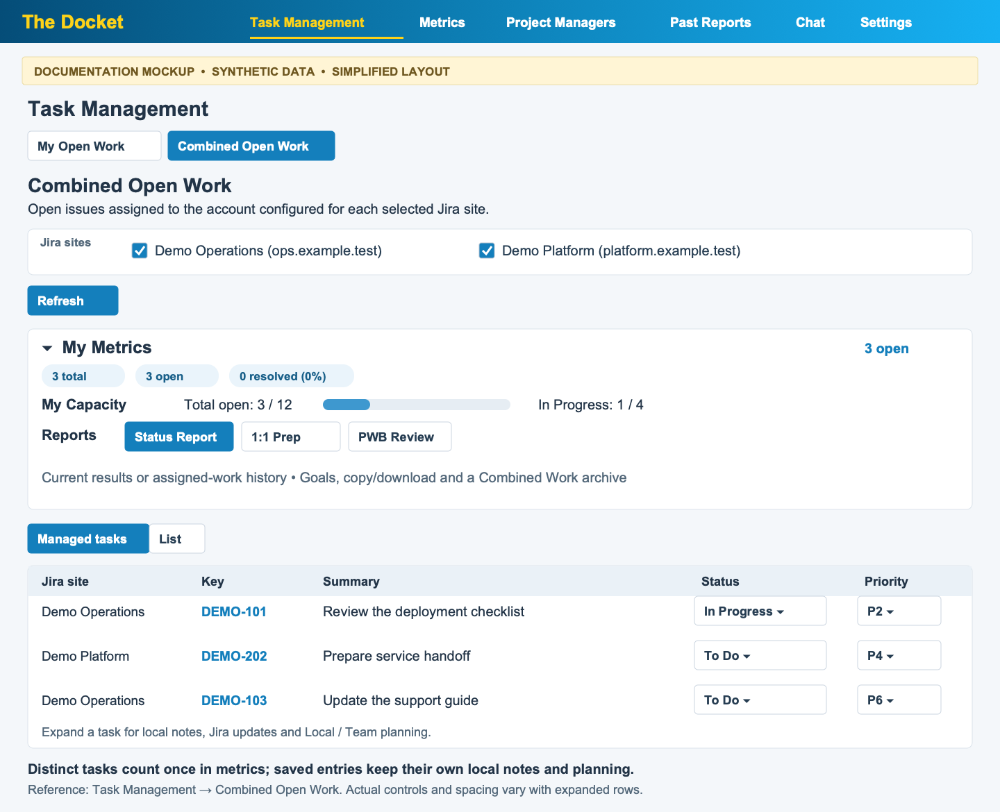
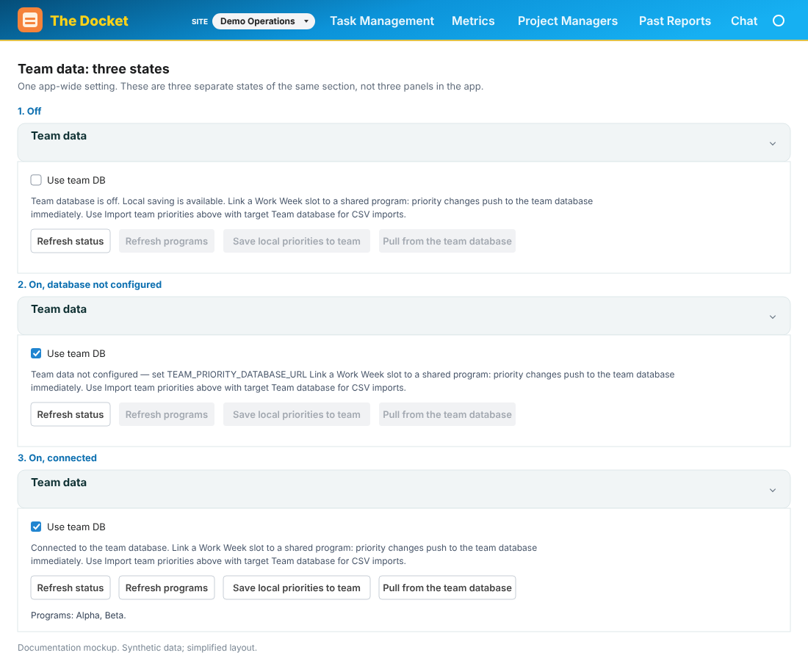
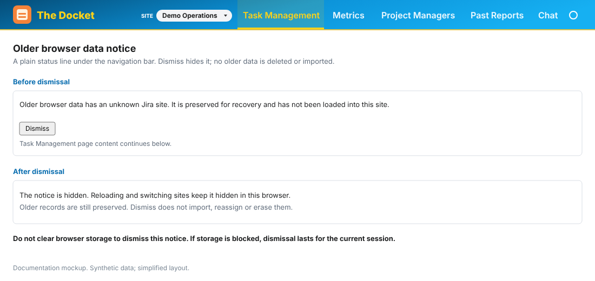
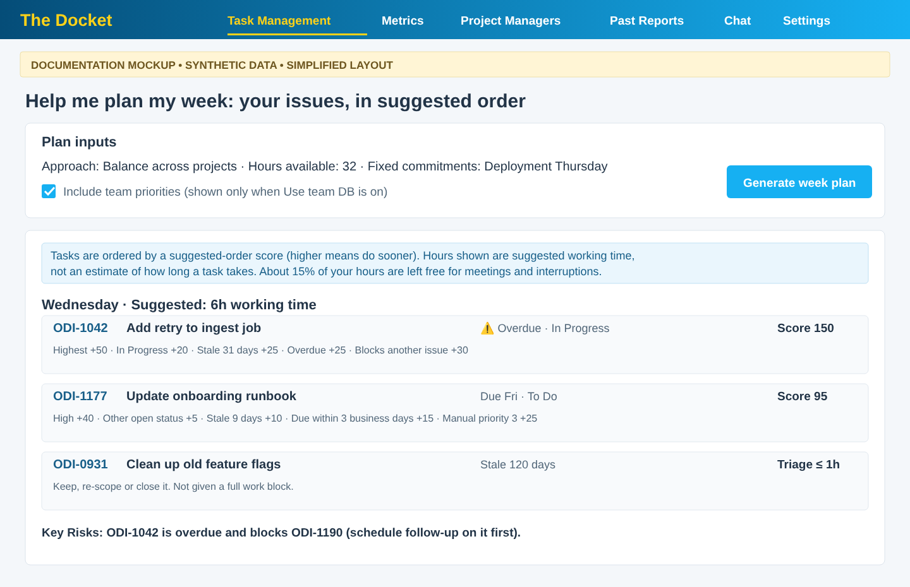
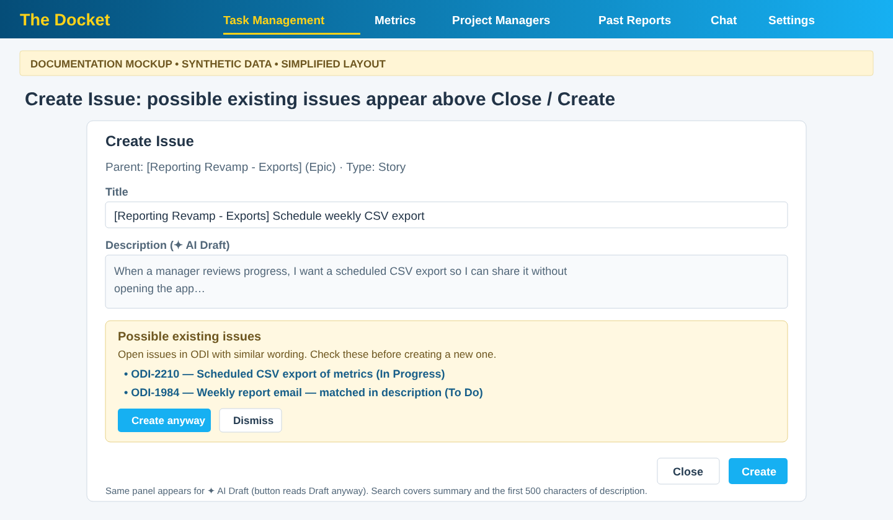
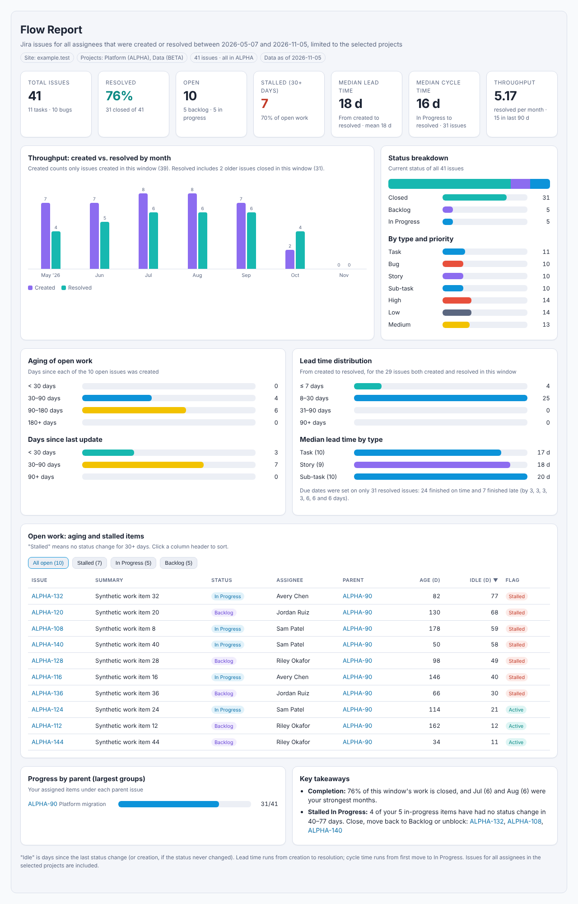
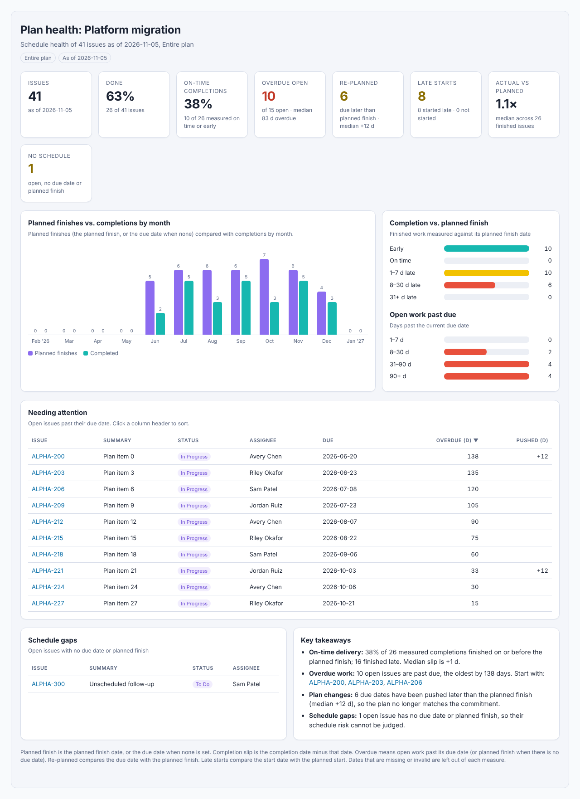

# Screenshots and mockups

[← README](../README.md)

## Current workflow mockups

**Combined Open Work — Managed tasks, My Metrics, and source-aware editing**

*Documentation mockup — synthetic data; simplified layout.*

**Settings → Team data — explicit, optional team database access**

*Documentation mockup — synthetic data; simplified layout.*

**Older browser data — dismiss the notice while preserving the original data**

*Documentation mockup — synthetic data; simplified layout.*

**Help me plan my week — your issues only, in suggested order, with a score key**

*Documentation mockup — synthetic data; simplified layout.*

**Create Issue — possible existing issues shown above Close / Create**

*Documentation mockup — synthetic data; simplified layout.*

**Flow Report — throughput, lead and cycle time, aging and stalled work**

*Documentation mockup — synthetic data; rendered from the report component.*

**Plan health — on-time delivery, overdue work and items needing attention**

*Documentation mockup — synthetic data; rendered from the report component.*

[Mockup sources and provenance](images/README.md).
