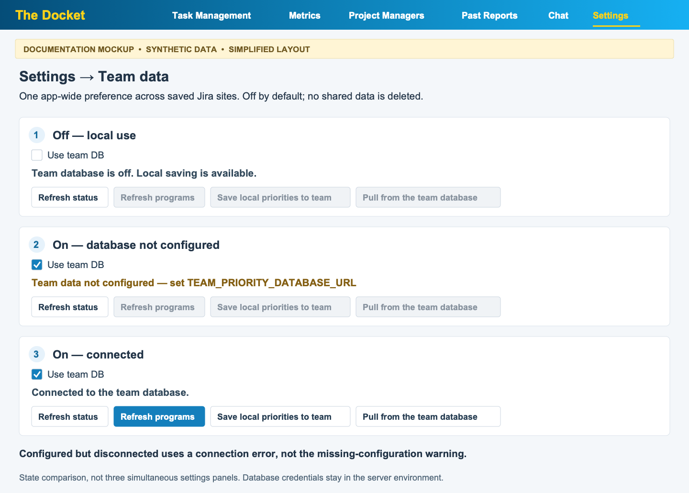

# Jira Setup

The Express proxy (`server/jiraProxy.mjs`) reads server-side credentials and authenticates Jira REST calls. The browser calls the proxy without receiving the Jira API token. Chat and report generation send selected context to the configured AI provider.

---

## 1. Create a Jira API token

1. Go to [https://id.atlassian.com/manage-profile/security/api-tokens](https://id.atlassian.com/manage-profile/security/api-tokens)
2. Click **Create API token**, give it a name (e.g. "Task Manager"), copy the token

---

## 2. Configure `.env`

**macOS / Linux (Terminal):**
```bash
cp .env.example .env
```

**Windows (PowerShell, from the project folder):**
```powershell
Copy-Item .env.example .env
```

**Windows (CMD):**
```cmd
copy .env.example .env
```

Open `.env` in any text editor and fill in the values below. Use the `.env` in the project copy you launch: the API loads it beside that copy's `package.json`. Separate Git worktrees do not share this file. Stop and restart the running API after edits; switching branches or opening another project folder does not restart an existing server.

| Variable | Example | Notes |
|----------|---------|-------|
| `JIRA_BASE_URL` | `https://yourcompany.atlassian.net` | No trailing slash |
| `JIRA_EMAIL` | `you@yourcompany.com` | Atlassian account email |
| `JIRA_API_TOKEN` | `ATATTxxx...` | From step 1 |
| `API_PORT` | `8787` | Optional; default is `8787` |
| `LOG_LEVEL` | `info` | Optional; controls server log verbosity — `error`, `warn`, `info` (default), or `debug` |

### Single site (legacy) vs multiple sites

| Setup | Registry | Local SQLite | Jira credentials |
|-------|----------|--------------|------------------|
| **Legacy** — only `JIRA_BASE_URL`, `JIRA_EMAIL`, `JIRA_API_TOKEN` | Empty | `data/workweek.sqlite` (unchanged for existing installs) | Read from `.env` |
| **Env seed** — at least one `JIRA_INSTANCE_N_BASE_URL` (+ matching `_EMAIL`, optional `_NAME`) for N=1…5 | Populated at API startup | `data/workweek-<instanceId>.sqlite` per registered site | Saved URL/email plus shared `JIRA_API_TOKEN` |
| **Settings** — add/edit sites in the app | Populated in UI | Per-site files as above | Saved URL/email plus shared `JIRA_API_TOKEN` |

Startup **does not** create registry rows from bare legacy `JIRA_*` alone. Use legacy mode for one site with your existing database, or set explicit `JIRA_INSTANCE_N_*` vars (or **Settings → Jira sites**) to use the instance registry.

When the registry has at least one row, the active site's saved URL and email are used for Jira proxy calls. `JIRA_BASE_URL` and `JIRA_EMAIL` are used only when the registry is empty. Every site uses the single server-side `JIRA_API_TOKEN`; numbered `JIRA_INSTANCE_N_API_TOKEN` values and previously saved tokens are not used for requests.

Optional env vars (see `.env.example`):

| Variable pattern | Notes |
|------------------|-------|
| `JIRA_INSTANCE_N_NAME` | Display name (N = 1…5) |
| `JIRA_INSTANCE_N_BASE_URL` | No trailing slash; **any** set `N` triggers startup seeding when the registry is empty |
| `JIRA_INSTANCE_N_EMAIL` | Atlassian account email |

Hard cap: **5** sites total. Settings stores site URLs and emails, not new API tokens. Keep `JIRA_API_TOKEN` in the server environment; list/get instance APIs never return tokens.

**In the app:** **Settings → Jira sites** — add, edit, remove, **Set active**, and **Test connection** (modal). **Header → Site** dropdown switches the active site when two or more are registered; site-scoped pages reload their data so presets, notes, and metrics match that saved entry. With only legacy `.env` credentials, the header shows **Jira** (link/tooltip points you to Settings to add more sites).

### Combined Open Work setup

Combined Open Work uses enabled saved Jira entries, including when you normally use only one site. Add entries in **Settings → Jira sites**, test their connections, then open **Task Management → Combined Open Work**, select the entries and click **Load open work**. The active Jira site stays unchanged. **Managed tasks** supports source-bound editing; **List** provides an overview. My Metrics, report goals, and the **Past Reports → Combined Work** archive use a separate Combined Work scope. See the [user guide](./END_USER_GUIDE.md#combined-open-work).

### Optional team database (PostgreSQL)

Local work does not require a company database. **Settings → Team data → Use team DB** defaults to off even if a URL is configured. The switch is app-wide, persisted across site changes and server restarts.

1. Have the database owner provide an approved PostgreSQL database and credentials. Set server-only `TEAM_PRIORITY_DATABASE_URL` with an explicit user, hostname, and database. If required, set `TEAM_PRIORITY_DATABASE_CA_FILE` to an absolute PEM trust-file path.
2. Export that environment for the migration command, then run `npm run team-db:migrate`. The migration CLI does **not** load `.env`; the API does load its normal project `.env`. Migrations are explicit and do not run at API startup.
3. Restart the API using your normal browser or desktop workflow after changing its environment.
4. Open **Settings → Team data**, select **Use team DB**, and click **Refresh status**. Confirm **Connected to the team database.** before Team saves, imports, or exports.

Remote PostgreSQL requires verified TLS; optional CA and URL restrictions, backup guidance, and explicit old-demo import steps are in [README → Optional shared team data](../README.md#optional-shared-team-data-postgresql). Do not place database credentials in browser settings or commit them.

The warning **Team data not configured — set TEAM_PRIORITY_DATABASE_URL** appears only after a successful check confirms enabled + unconfigured. Off, loading, failed checks, and configured-but-disconnected states are distinct. A missing schema requires the migration command. Turning Team off keeps local work and Team drafts; explicit Team actions are blocked without switching their destination to Local. Work already dispatched may finish. Refresh other browser tabs to see the current preference.


*Documentation mockup — synthetic data; simplified layout.*

### Local data and recovery

Saved-entry notes, presets, and ordinary archives use `data/workweek-<instanceId>.sqlite`; legacy single-site data uses `data/workweek.sqlite`. The registry and Team preference use `data/instances-meta.sqlite`, personal To Dos use `data/personal-todos.sqlite`, and Combined Work goals/archive use `data/docket-combined.sqlite`. Keep those distinct stores when planning a backup; the [developer guide](./DEVELOPER_GUIDE.md#local-stores-and-request-context) describes their scope.

An **Older browser data has an unknown Jira site** banner means original unscoped browser records were preserved without being assigned to a site. **Dismiss** acknowledges the notice in this browser without deleting or importing records; if browser storage is blocked it lasts for the session. Do not infer ownership from an issue key alone. Personal To Do migration has a separate recovery notice for ambiguous source records.

### Chat & AI (explicit opt-in)

| Variable | Example | Notes |
|----------|---------|-------|
| `CHAT_PROVIDER` | `anthropic` | **Required** to enable chat. Use `openai`, `ollama`, `rovo`, or `disabled`. Unset = chat off |
| `ANTHROPIC_API_KEY` | `sk-ant-...` | Required when `CHAT_PROVIDER=anthropic` |
| `ANTHROPIC_MODEL` | `claude-sonnet-4-6` | Optional model override |
| `ANTHROPIC_BASE_URL` | `https://api.anthropic.com` | Optional; custom Anthropic-compatible API host |
| `OPENAI_API_KEY` | `sk-...` | When `CHAT_PROVIDER=openai` or `REPORT_PROVIDER=openai` |
| `OPENAI_BASE_URL` | `https://api.openai.com/v1` | OpenAI-compatible endpoints (Databricks, Azure, LiteLLM, vLLM) |
| `OPENAI_MODEL` | `gpt-4o-mini` | Optional OpenAI / compatible model name |
| `OLLAMA_BASE_URL` | `http://localhost:11434` | When `CHAT_PROVIDER=ollama` or `REPORT_PROVIDER=ollama` |
| `OLLAMA_MODEL` | `llama3.2` | Local model for chat (and reports if `OLLAMA_REPORT_MODEL` unset) |
| `OLLAMA_REPORT_MODEL` | `llama3.3:70b` | Optional larger local model for reports only |
| `REPORT_PROVIDER` | `openai` | Optional; reports use this provider instead of `CHAT_PROVIDER` |
| `REPORT_OPENAI_API_KEY` | | Optional report-only OpenAI key (falls back to `OPENAI_API_KEY`) |
| `REPORT_OPENAI_BASE_URL` | | Optional report-only OpenAI-compatible URL |
| `REPORT_OPENAI_MODEL` | | Optional report-only model name |
| `REPORT_ANTHROPIC_API_KEY` | | Optional report-only Anthropic key (falls back to `ANTHROPIC_API_KEY`) |
| `REPORT_ANTHROPIC_BASE_URL` | | Optional report-only Anthropic-compatible URL |
| `REPORT_ANTHROPIC_MODEL` | | Optional report-only Anthropic model |
| `ATTACHMENT_MAX_MB` | `250` | Optional per-file limit for Create Issue / Task Management attachments. Jira's own site limit still applies. |
| `LLM_TIMEOUT_MS` | `180000` | Optional request timeout for Anthropic / OpenAI / Managed AI calls |
| `OLLAMA_TIMEOUT_MS` | `600000` | Optional request timeout for Ollama calls |
| `AI_DRAFT_TIMEOUT_MS` | `120000` | Optional timeout for Create Issue **AI Draft** (any provider) |
| `MANAGED_AI_BASE_URL` | `https://<company-gateway>/v1` | Company OpenAI-compatible gateway (Managed / Company AI) |
| `MANAGED_AI_API_KEY` | | Token for the company gateway |
| `MANAGED_AI_MODEL` | | Pinned company model id |
| `AI_MODE` | `managed` or `local` | Optional host lock; overrides the Settings AI path choice |

Chat and reports use the same provider (`CHAT_PROVIDER`) unless you set `REPORT_PROVIDER`. All three built-in providers (`anthropic`, `openai`, `ollama`) can generate reports and week plans.

When **Managed / Company AI** is configured (`MANAGED_AI_BASE_URL`, `MANAGED_AI_API_KEY`, and `MANAGED_AI_MODEL` all set), it is the default for chat and reports. Users switch to Local only in **Settings → Chat assistant** when both paths are ready. The app does not silently fall back from Managed to Local on errors — a failed Managed call surfaces the error. `REPORT_PROVIDER` and `REPORT_*` credentials apply only while **Local** is the active path.

> **Never commit `.env`** — it is in `.gitignore`.

---

## 3. Install and start

**Prerequisites:** Node **22** (see `.nvmrc`). On Windows, install from [nodejs.org](https://nodejs.org/) or use `nvm-windows` / `fnm` — match major version 22.

```bash
npm install
```

`npm install` rebuilds `better-sqlite3` for Node. Browser API startup also rebuilds for Node; desktop startup uses the existing Electron rebuild. Stop the running workflow before switching between browser and desktop mode.

**Browser mode (Vite + proxy)** — macOS, Windows, or Linux:
```bash
npm run dev:all
# → UI at http://localhost:5173
# → API at http://localhost:8787
```

**Desktop dev (Vite + Electron)** — macOS or Windows:
```bash
npm run desktop:dev
```

Some corporate secure laptops may block Electron windows or local desktop app execution. If this option is unavailable, run browser mode with `npm run dev:all`, then set the browser UI up as its own desktop-style app window from Chrome or Edge; see [END_USER_GUIDE.md](./END_USER_GUIDE.md#install-as-its-own-application-window).

If `better-sqlite3` still fails after `npm install`:
```bash
npm run desktop:rebuild-native
```

---

## 4. Verify the connection

Inside the app: **Settings → Test Jira Connection**

Or directly in a browser: `http://localhost:8787/api/health`

A successful response looks like:
```json
{
  "ok": true,
  "jiraBaseUrl": "https://yourcompany.atlassian.net",
  "jiraInstanceId": null,
  "jiraInstanceName": "",
  "legacyMode": true
}
```

With a registered active site, `legacyMode` is `false`, `jiraInstanceId` is set, and `jiraInstanceName` matches **Settings → Jira sites**.

---

## 5. Set up presets (required for Metrics + Chat)

**Pilot shortcut:** after `npm install` and a first API start, seed shared presets:

```bash
npm run seed:presets -- --all
```

The [preset catalog](../presets/pilot-presets.json) supplies the entries; see the [seeding script](../scripts/seed-epic-presets.mjs) for selection options.

**Manual setup:**

1. Settings → **Epic & JQL presets** → Add preset
2. For each project you want to track, add either:
   - **Epic preset**: epic key (e.g. `PROJ-1234`) + a label
   - **JQL preset**: a saved JQL query + a label

These presets appear in the Metrics filter panel, the Task Management **Create Issue** modal (epic presets and saved queries — JQL presets can resolve parents from query results when no single epic key is embedded), and the Chat context panel.

---

## 6. Map Jira date fields (required for deadline tracking)

The app needs to know which Jira custom fields hold your deadline dates.

1. Settings → **Jira field mapping** → **Refresh from Jira**
2. This auto-populates field IDs from your Jira instance
3. Map the four roles to the correct Jira fields:
   - **Initial Done Date** → your "Automation Done Date" or equivalent
   - **Most Recent Done Date** → updated on each deadline revision
   - **Due date** → standard Jira due date field
   - **Project End Date** → project-level end date

4. Click **Save field mappings**

> Your Jira project may use `customfield_10008` (Initial Done Date) and `customfield_10009` (Most Recent Done Date). These are pre-mapped in `server/lib/jiraSearchFields.mjs` as fallbacks.

---

## 7. Configure past due rules

Settings → **Past due rules** → choose which date field triggers the "Past Due" badge on epic cards:

| Option | Meaning |
|--------|---------|
| Either (default) | Past due if **Most Recent Done Date**, **Initial Done Date**, or **Project End Date** has passed (open epic) |
| Most Recent Done Date | Only that Automated Done Date field triggers past due |
| Project End Date | Only that field triggers past due |

Open **tasks/stories** in overdue metrics also count when standard **Due date**, **Most Recent Done Date**, or **Initial Done Date** on the issue itself is before today. Epic-level Automated Done Date fields (`customfield_10008` / `customfield_10009`) are the primary deadlines for your Jira project's epics.

---

## 8. Chat, reports, and optional providers

**Setup:** set `CHAT_PROVIDER` and the matching credentials in `.env`. Chat is disabled until you do. Reports and week plans use the same provider unless you set `REPORT_PROVIDER`.

### Managed vs Local (Company AI)

| Path | Config | Notes |
|------|--------|-------|
| **Managed (default when ready)** | `MANAGED_AI_BASE_URL` + `MANAGED_AI_API_KEY` + `MANAGED_AI_MODEL` | OpenAI-compatible company gateway; used for chat and reports |
| **Local** | `CHAT_PROVIDER` + matching provider vars | Full BYO stack: `anthropic`, `openai`, `ollama`, or `rovo` |
| **Host lock** | `AI_MODE=managed` or `AI_MODE=local` | Ops override; wins over the Settings preference |

When both Managed and Local are ready, the app defaults to **Company AI**. Switch to Local in **Settings → Chat assistant** only — Chat and report pages show status (e.g. “Using Company AI”) and link to Settings; they do not duplicate the switch. If a Managed call fails, the error is shown; the app does **not** silently retry on Local. `REPORT_PROVIDER` and `REPORT_*` vars are **Local-only** — ignored while Managed is the active path.

| Goal | `.env` setup |
|------|----------------|
| Anthropic (chat + reports) | `CHAT_PROVIDER=anthropic` + `ANTHROPIC_API_KEY` |
| OpenAI (chat + reports) | `CHAT_PROVIDER=openai` + `OPENAI_API_KEY` |
| OpenAI-compatible (Databricks, Azure, LiteLLM, vLLM) | `CHAT_PROVIDER=openai` + `OPENAI_API_KEY` + `OPENAI_BASE_URL` + `OPENAI_MODEL` |
| Local Ollama (chat + reports) | `CHAT_PROVIDER=ollama` + `OLLAMA_BASE_URL` (+ optional `OLLAMA_REPORT_MODEL` for a larger report model) |
| Ollama chat + cloud reports | `CHAT_PROVIDER=ollama` + `REPORT_PROVIDER=openai` (+ report OpenAI vars; use `REPORT_OPENAI_*` if different from chat) |
| Turn chat off | `CHAT_PROVIDER=disabled` or leave unset |
| **Rovo (opt-in)** | `CHAT_PROVIDER=rovo` + OAuth vars below |

### Rovo opt-in (Atlassian)

Only use if your Jira Cloud org has Rovo MCP enabled.

1. Set `CHAT_PROVIDER=rovo` and the OAuth variables below.
2. Configure an OAuth 2.0 (3LO) app in the [Atlassian developer console](https://developer.atlassian.com/console/myapps/) with callback URL matching `CHAT_OAUTH_REDIRECT_URI`.
3. In Chat, click **Sign in with Atlassian** (or open `GET /api/chat/auth/start` in the browser). The proxy redirects to Atlassian with `prompt=consent` so scopes are granted explicitly.
4. After approval, Atlassian redirects to `GET /api/chat/auth/callback`; tokens are stored in SQLite (`chat_sessions`).
5. To switch accounts or refresh consent, use **Sign out** in Chat (`POST /api/chat/auth/signout`) and sign in again.

| Variable | Notes |
|----------|-------|
| `CHAT_PROVIDER` | `rovo` |
| `ATLASSIAN_OAUTH_CLIENT_ID` | From Atlassian developer console |
| `ATLASSIAN_OAUTH_CLIENT_SECRET` | OAuth client secret |
| `CHAT_OAUTH_REDIRECT_URI` | `http://localhost:8787/api/chat/auth/callback` (match port/host in production) |

**OAuth scopes** (requested by the proxy on sign-in):

`read:jira-work write:jira-work offline_access search:rovo:mcp read:me`

`offline_access` enables refresh tokens; `search:rovo:mcp` is required for Rovo MCP search.

**LLM fallback:** Chat is considered ready when you are signed in to Atlassian **or** when an LLM key is configured (`ANTHROPIC_API_KEY`, `OPENAI_API_KEY`, or `OLLAMA_BASE_URL`). If Rovo MCP fails or you are not signed in, the proxy answers via the configured LLM and returns a `note` in the chat response (e.g. "Rovo MCP unavailable; answered via configured LLM fallback."). Configure at least one LLM key on the proxy host for reliable chat when Rovo is down.

### Chat session context

Each Chat message includes **session context** assembled in the browser and sent as part of `epicContext.sessionContext` on `POST /api/chat`:

| Included data | Source |
|---------------|--------|
| Task Management JQL summaries | `localStorage` (`workWeekTasksJiraLastJqlRuns`) — last Run JQL results |
| Metrics summary | `GET /api/dashboard/metrics` — refreshed when Chat loads and on each send |
| Generated artifacts | `localStorage` (`taskManagerChatSessionArtifacts`) — last 8 reports/plans |
| Past Reports archive | SQLite (`generated_reports`) — all auto-saved reports/plans plus Chat saves |

Artifacts are saved automatically when the user generates a Task Management project report, week plan, or Metrics audience report (also written to **Past Reports** in SQLite). Chat replies are **not** auto-archived — use **Save to Past Reports** on the assistant bubble. The proxy formats session context into the system prompt via `shared/chatSessionPrompt.mjs` so the model can answer questions like "what did my week plan say?" without re-running Jira searches.

Session context stays in the browser and SQLite (dashboard snapshot + archived reports); only the formatted prompt text is sent to your LLM provider (or Rovo) with each chat message.

### OpenAI-compatible providers

Most enterprise and self-hosted gateways expose an **OpenAI-compatible** `/chat/completions` API. Point the app at that URL — no code changes:

```env
CHAT_PROVIDER=openai
OPENAI_API_KEY=<your-token>
OPENAI_BASE_URL=https://<host>/.../v1
OPENAI_MODEL=<model-name>
```

Use the same pattern for **reports only** on a different endpoint:

```env
CHAT_PROVIDER=ollama
OLLAMA_BASE_URL=http://localhost:11434
REPORT_PROVIDER=openai
REPORT_OPENAI_API_KEY=<databricks-token>
REPORT_OPENAI_BASE_URL=https://<workspace-host>/serving-endpoints/<endpoint>/invocations/v1
REPORT_OPENAI_MODEL=claude-sonnet-...
```

For Databricks, Azure, LiteLLM, vLLM, or similar gateways, confirm the endpoint supports chat completions, create a token with permission to call it, ensure the proxy machine can reach the URL, then set the OpenAI-compatible variables above and restart the API.

If your endpoint uses a different request format (not OpenAI chat completions or Anthropic messages), you would need a dedicated provider in `server/lib/llmClient.mjs`.

---

## Ports

| Service | Default port | Config |
|---------|-------------|--------|
| Vite dev server (UI) | `5173` | `vite.config.js` |
| Express proxy (API) | `8787` | `API_PORT` in `.env` |

If a port is already in use:

**macOS / Linux:**
```bash
lsof -nP -iTCP:8787 -sTCP:LISTEN
```

**Windows (PowerShell or CMD):**
```cmd
netstat -ano | findstr :8787
```

---

## Desktop app (local Electron development)

Packaged installers, including unsigned Mac `.dmg` and Windows NSIS installers, are unsupported. The installer scripts and packaging workflow have been removed. Use the project checkout, Node, dependencies, and project `.env` described above, then run:

```bash
npm run desktop:dev
```

Electron starts the local proxy and loads the Vite UI at `http://localhost:5173`. Local development uses the project `.env` and `data/` folder. If a native SQLite ABI error persists, stop the app and run `npm run desktop:doctor` to rebuild for Electron and relaunch.

For browser mode, stop the desktop workflow and run `npm run dev:all`; its API startup rebuilds SQLite for Node. If needed, run `npm rebuild better-sqlite3` first. On devices that block Electron, use browser mode and optionally [install the browser UI as its own application window](./END_USER_GUIDE.md#install-as-its-own-application-window).

---

## Browser vs desktop mode

| Mode | How the proxy URL is resolved |
|------|------------------------------|
| Desktop (dev) | Vite at `localhost:5173`; proxy spawned by Electron; repo `data/` + `.env` |
| Browser dev (`dev:all`) | Vite proxies `/api/*` to `localhost:8787` via `vite.config.js` |
| Browser production | Set **App URL** in Settings → Past due rules to `http://localhost:8787` |
