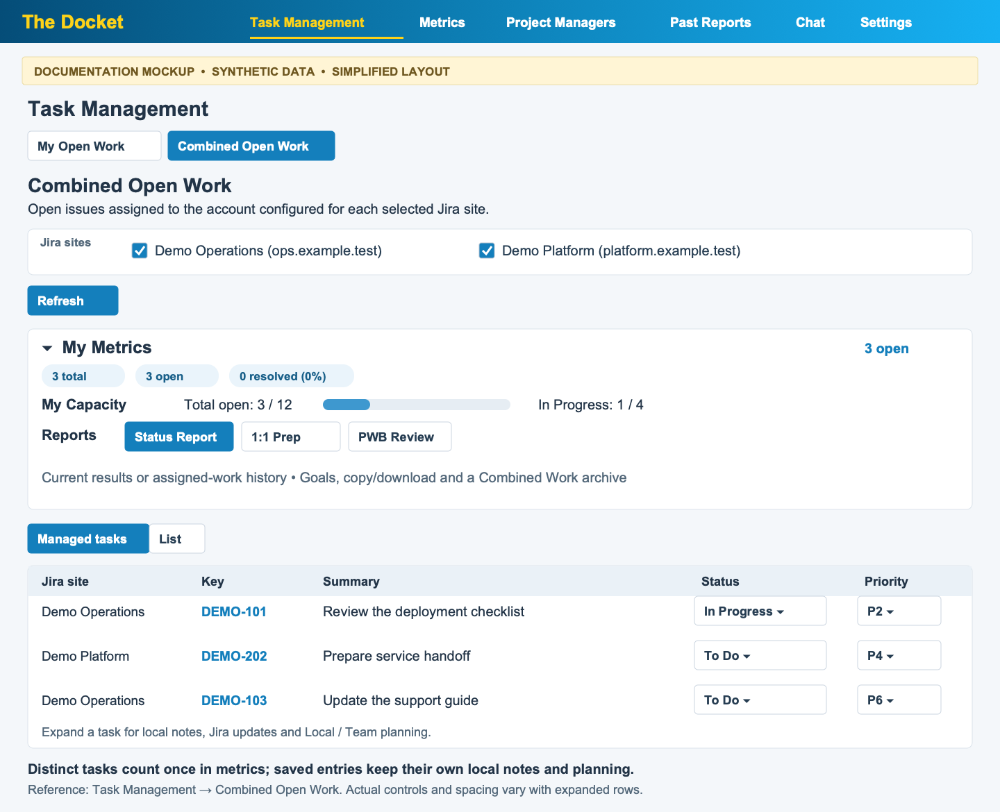

# Combined Open Work

[← User Guide index](../END_USER_GUIDE.md)

1. Add the Jira entries you need in **Settings → Jira sites**.
2. In Task Management, select the **Combined Open Work** result tab, choose the saved entries, and click **Load open work**.
3. Use **Managed tasks** to edit work in one table, or **List** for a compact overview. Each row names its Jira source; editing uses that saved source without switching the active site.
4. Open **My Metrics → Combined Work Report** for **Current query results** or **All my assigned work**. Choose **Status Report**, **1:1 Prep**, or **PWB Review**, then use the existing generate, copy, and download controls.

Open work means issues assigned to each entry's configured account whose Jira status category is not Done. Duplicate hostname/issue-key pairs count once in workload totals; rows, local notes, and planning remain separate for each saved entry. Managed editing uses the existing status, assignee, priority, notes/attachments, dates, and planning controls. Local and Team values remain separate; Team requires the opt-in and a working connection.

Source metadata must finish loading before editing. Successful rows remain visible if another source fails. Partial or failed sources and bounded history searches retain coverage notices, including in generated reports. **Refresh** recollects the selected sources; **Cancel** stops collection. Wait for pending saves before changing selection or refreshing.

Combined Work has one set of personal and company/team report goals across source selections. Its reports appear in **Past Reports → Combined Work**, separate from ordinary site reports and goals. It uses your existing AI provider setup.

*Documentation mockup — synthetic data; simplified layout.*

---

[← User Guide index](../END_USER_GUIDE.md)
