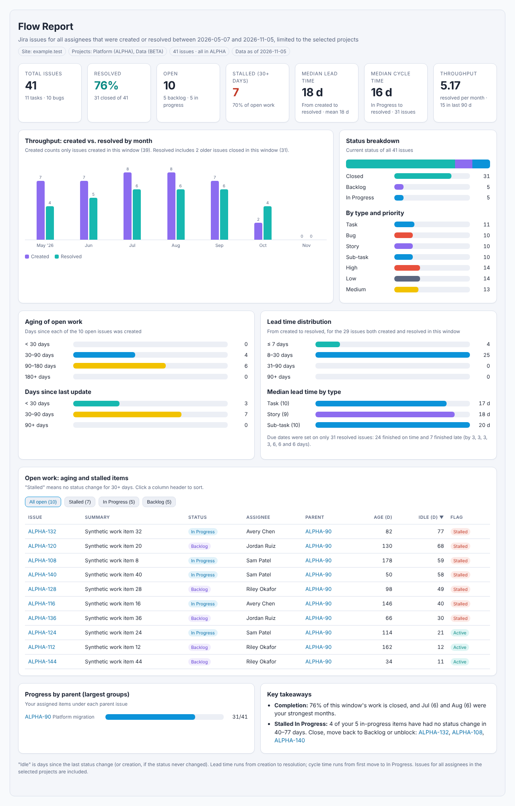
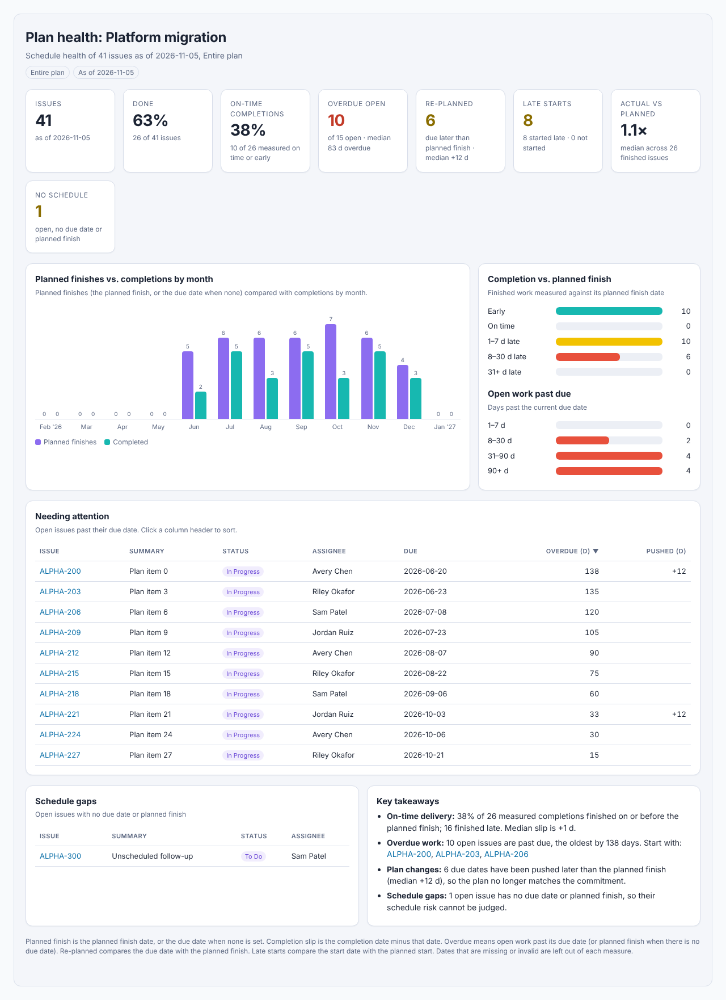

# Flow Report and Plan health

[← User Guide index](../END_USER_GUIDE.md)

Two native reports that answer "how is work actually moving?" without leaving the app. Both are calculated from Jira data with fixed formulas. AI is only used for an optional written summary, so every number can be traced back to issues.

| Report | Question it answers | Where it lives |
|---|---|---|
| **Flow Report** | How much work is created and finished, how long it takes, and what is stuck? | **Metrics**, **Task Management → My Metrics**, **Combined Open Work** |
| **Plan health** | Is the plan on track: on-time delivery, overdue work, moved due dates? | **Project Managers → Gantt** |

All screenshots on this page are [documentation mockups with synthetic data](../images/README.md).

## Flow Report

*Documentation mockup — synthetic data.*

### Where to find it

- **Metrics** — a **Flow Report** card. It uses the project presets you selected at the top of the page, and includes **all assignees** (not just you). You can also change the project selection inside the card.
- **Task Management → My Metrics** — a collapsed **Flow report** section for **your** issues only.
- **Combined Open Work** — a **Combined Flow report** card that merges the saved Jira sites you selected on that page. A site that cannot be reached is listed as skipped; the other sites are still reported.

### Generating one

1. Choose the time window: **3, 6, 12 or 24 months**.
2. *(My Metrics only)* Tick **Include work I've handed on** to count issues that were assigned to you earlier but now belong to someone else.
3. Click **Generate**. If you change the project selection afterwards, click **Regenerate** — the report always reflects the selection that was in place when it was generated, and a warning appears if the two differ.
4. Open **Query used** to see the exact JQL.

### What the report shows

| Section | How to read it |
|---|---|
| **KPI row** | Total issues, % resolved, open, stalled (no status change for 30+ days), median lead time (created → resolved), median cycle time (first move to In Progress → resolved), and throughput per month. |
| **Created vs. resolved by month** | Bars per month. Resolved can include older issues closed inside the window. |
| **Status breakdown / type and priority** | Current status of every issue in scope. |
| **Aging of open work** and **Days since last update** | How old open issues are, and how long since anything changed. |
| **Lead time distribution** and **by type** | Spread of created → resolved times. A note counts how many resolved issues finished on time against their due date. |
| **Open work: aging and stalled items** | Sortable table with **Assignee**, parent, age, idle days and a **Stalled** flag. Use the filter chips to narrow to Stalled, In Progress or Backlog. |
| **Progress by parent** | Resolved vs. total for the largest parent issues or epics. |
| **Key takeaways** | A short list generated from the numbers, with links to the issues to look at first. |

"Idle" is days since the last status change, or since creation when the status never changed.

### Saving and sharing

- **Save to archive** keeps the full report in **Past Reports** (type **Flow report**) so you can reopen it later exactly as generated.
- **Copy** / **Download .md** produce markdown. **Download .html** produces one self-contained file that opens without the app.
- **Add AI summary** (needs Chat configured) writes a short narrative from the calculated numbers. It never replaces the figures.

## Plan health (Gantt)

*Documentation mockup — synthetic data.*

Open **Project Managers → Gantt**, pick a source, and click **Plan health…** in the toolbar. The report is built from the issues already loaded on the Gantt, so there is no extra Jira search.

### Choosing what the Gantt shows

The source dropdown lists:

- **Pinned Issues** (default) and **Programs**, as before.
- **Projects, people and saved filters** — your saved presets from Settings → **Epic & JQL presets** (epics, Jira filters, JQL).
- **Custom JQL…** — type a query and click **Load**.

Presets and custom JQL load up to 1,000 issues. "Open only" status filters in presets are dropped so finished work stays on the plan. While data loads you will see a spinner, or a progress bar when refreshing.

### Scope

Plan health has its own toggle: **Entire plan** or **Current view** (respects status filters and search). Switching it recalculates everything.

### What the report shows

| Measure | Definition |
|---|---|
| **Planned finish** | The planned finish date, or the due date when none is set. |
| **On-time completions** | Finished work whose completion date is on or before its planned finish. |
| **Completion vs. planned finish** | Early, on time, 1–7, 8–30 and 31+ days late. |
| **Overdue open** | Open work past its due date (or planned finish when there is no due date), bucketed by how long. |
| **Re-planned** | Due date later than the planned finish: the commitment moved. |
| **Late starts** | Started after the planned start, or past the planned start and not started. |
| **Actual vs. planned** | Median ratio of actual to planned duration for finished issues. |
| **No schedule** | Open issues with no due date or planned finish; their risk cannot be judged. |

The **Needing attention** table lists overdue issues (sortable, with days overdue and days pushed). Dates that are missing or invalid are left out of a measure rather than counted as zero; the footnote explains this.

### Tracking changes over time

**Save snapshot to archive** stores the report (type **Plan health** in Past Reports). The next time you open Plan health for the same source and scope, a **Changes since…** card shows which due dates moved, what finished, and what was added or removed. Snapshots are only compared when the scope matches, so save **Entire plan** snapshots to track the whole plan.

### Exports

- **Copy markdown**, **Download .md** and **Download .html** from the Plan health panel.
- **SharePoint report…** has an **Include plan health** checkbox. It adds the full plan health section (KPIs, takeaways, monthly chart, delivery breakdowns, items needing attention, schedule gaps and footnote) above the timeline, using plain tables so it survives SharePoint's HTML cleanup. **Save to archive** in that panel stores a plan health snapshot for the selected scope, including your summary text.

The existing SharePoint HTML and PNG exports are unchanged when the checkbox is off.

## Related

- [Metrics — project-level view](metrics.md)
- [Task Management — My Metrics](task-management.md#my-metrics)
- [Project Managers — Gantt tab](project-managers.md#gantt-tab)
- [Combined Open Work](combined-work.md)
- [Past Reports and Chat](reports-and-chat.md)
