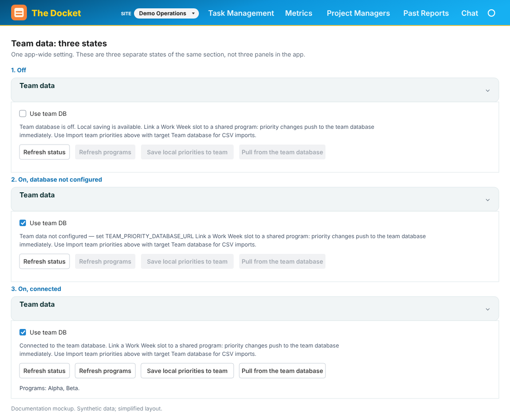
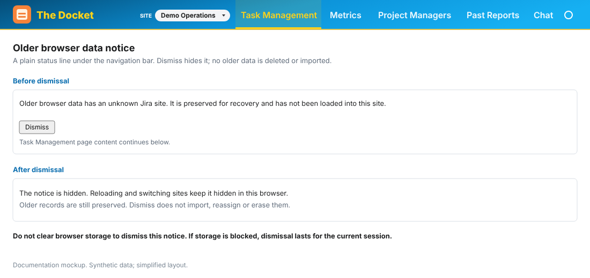

# Getting started

[← User Guide index](../END_USER_GUIDE.md)

## Using The Docket in the browser (when the desktop app is unavailable)

If the packaged desktop app or Electron window is unavailable or blocked (for example on a corporate secure laptop, by macOS, or by work security software), use the **browser UI** instead and install it as its own application window. You get the same pages; only the window chrome is different.

### Start the app

From the project folder, in a terminal:

```bash
npm run dev:all
```

Leave that terminal open. Then open **http://localhost:5173** in Chrome or Edge.

### Install as its own application window

Chrome and Edge can open the site in a standalone window (similar to Microsoft 365 as an app), with a Dock / taskbar icon:

**Google Chrome**

1. Open **http://localhost:5173** while `npm run dev:all` is running.
2. Menu (**⋮**) → **Cast, save, and share** → **Install page as app…**  
   (wording may vary slightly by Chrome version; look for **Install app** / **Install The Docket**).
3. Confirm. A separate window opens; you can pin it to the Dock.

**Microsoft Edge**

1. Open **http://localhost:5173**.
2. Menu (**⋯**) → **Apps** → **Install this site as an app**.
3. Name it **The Docket** if prompted, then install.

**Safari (macOS)**

With the site open: **File → Add to Dock** (label may vary by macOS version).

### Important

- The installed window still needs **`npm run dev:all` running** in a terminal. If you quit that process, the app cannot reach Jira or save notes.
- Prefer Chrome or Edge for “Install as app.” The install dialog shows the name **The Docket** and the app icon (not “localhost”).
- For packaged DMG/NSIS that warn on first open (unsigned builds), see [unsigned-installs.md](../unsigned-installs.md).

---


## The six tabs

```
Task Management  |  Metrics  |  Project Managers  |  Past Reports  |  Chat  |  Settings
```

Navigate between them using the menu at the top of the screen.

---


## Settings — do this first

Configure Jira before loading or editing Jira issues. Personal To Dos work without a Jira connection, and a company database is optional.

**Developers (browser or desktop dev):** copy `.env.example` to `.env` in the project folder and fill in Jira credentials — see [JIRA_SETUP.md](../JIRA_SETUP.md).

**Local desktop app:** packaged Mac and Windows installers, including unsigned builds, are unsupported. Use a project checkout with Node and installed dependencies, configure the project `.env`, and run `npm run desktop:dev`. See the [quick start and native SQLite recovery](../../README.md#quick-start).

Then in the app:

1. Go to **Settings**
2. Click **Test Jira Connection**
3. If it shows ✓ Connected — you're good. Skip to Task Management below.
4. If it fails, check that your `.env` file has the right values (see [JIRA_SETUP.md](../JIRA_SETUP.md)).

### Switching Jira sites

Use this when you work across more than one Jira Cloud site (different company URLs).

- **One site from `.env` only:** keep using **Test Jira Connection** as above. Your notes and presets stay in the app’s usual database; the top bar shows **Jira** until you add more sites.
- **Several sites:** go to **Settings → Jira sites**. Add up to **five** sites (name, URL, email). The server uses `JIRA_API_TOKEN` from its environment for all entries; Settings does not accept tokens. Use **Set active** or the **Site** menu in the top bar to change which Jira the app talks to.
- **After you switch:** site-scoped pages reload their data. Presets, notes, and ordinary reports belong to the saved entry. Personal To Dos, the Team DB preference, and Combined Work goals/archive have their own app-wide scope.
- **Test before save:** in the add/edit dialog, use **Test connection** to confirm credentials.

Developers can also pre-register sites in `.env` with `JIRA_INSTANCE_1_*` … `JIRA_INSTANCE_5_*` (see [JIRA_SETUP.md](../JIRA_SETUP.md)); the app does not turn a single legacy `.env` site into a registry entry by itself at startup.

### Optional Team database

**Settings → Team data → Use team DB** is off by default, even if the server already has a database URL. The setting applies across all saved Jira sites and survives restart. Leave it off to use local notes, priorities, planning, and personal To Dos.

To use shared metadata, ask the database owner to complete [PostgreSQL configuration and migrations](../JIRA_SETUP.md#optional-team-database-postgresql), restart the API, then turn on **Use team DB**. Use **Refresh status** to check the connection. The exact warning **Team data not configured — set TEAM_PRIORITY_DATABASE_URL** appears only when a successful check confirms the switch is on and configuration is missing. A configured connection failure has a separate message.

Turning the switch off preserves local data and unsaved Team drafts. Team saves, imports, and exports stay unavailable until Team is ready; they do not silently save locally. Choose **Local** explicitly when that is your intended destination. An operation already sent may finish, and other open browser tabs may need a refresh.


*Documentation mockup — synthetic data; simplified layout.*

### Older browser data notice

If the banner says **Older browser data has an unknown Jira site**, the app has preserved old browser records without assigning them to the current site. Click **Dismiss** to acknowledge the notice. It stays hidden across reloads and site switches in this browser; the original data is neither deleted nor imported. With browser storage blocked, dismissal lasts for the current session. This is separate from the recovery notice for older personal To Dos.


*Documentation mockup — synthetic data; simplified layout.*

### Epic & JQL presets

These are the named saved searches that power everything else. Add them once in Settings; they'll appear in Task Management, Metrics, and Chat.

| Preset type | Use when |
|-------------|----------|
| **Epic** | You want metrics tied to a specific Jira epic (PROJ-1234) |
| **JQL** | You want a custom search — e.g. all issues assigned to you |

To add a preset:
1. Settings → **Epic & JQL presets** section
2. Choose type, fill in the label and JQL or epic key
3. Click **Add preset**

**Share presets with your team:** use **Export team pack** to download a JSON file of all epic/JQL presets. New teammates click **Import team pack** and choose **merge** (add new, skip duplicates) or **replace** (overwrite all local presets). Align with your team's canonical preset list or `npm run seed:presets` for admins — see [DEVELOPER_GUIDE.md](../DEVELOPER_GUIDE.md).

### Contributor Metrics

Add team members here by Jira display name so **Metrics** can track workload and overdue rate. You can also add reporter watches, saved preset watches, or custom JQL groups. Optional capacity targets appear on the **Project Managers** tab.

### Chat instructions

Optional. Anything you type here is added to every Chat conversation. Example:
```
Keep answers short. Always include the issue key. Use bullet points.
```

---

[← User Guide index](../END_USER_GUIDE.md)
