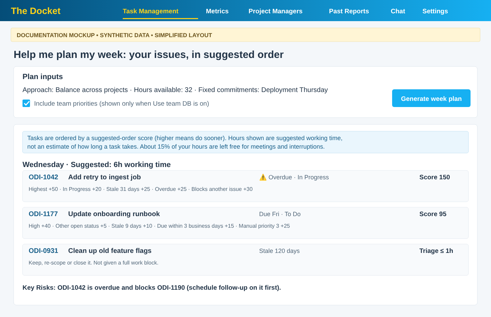

# Help me plan my week

[← User Guide index](../END_USER_GUIDE.md)

Click **🗓️ Help me plan my week** to expand. Answer a few questions:

| # | Question | Example answer |
|---|----------|---------------|
| 1 | How do you want to approach this week? | "Balance across projects" |
| 2 | How many hours available? | 32 |
| 3 | Fixed commitments or blockers? | "Deployment Thursday" |
| 4 | Any other context? | "Need to prep for Friday review" |
| 5 | Include a prior CoWork weekly plan? (optional) | Pick a `weekly-plan-*.md` from the data folder, or **None** |

Question 5 lists CoWork files already in the app data folder (same as **Past Reports → Files**). If you pick one, its content is sent as prior-plan context so the new plan can refine it against your current JQL tasks.

When **Use team DB** is on, an **Include team priorities** checkbox appears. Checked (the default), the plan ranks with team priorities layered over your own. Unchecked, it ranks on your own priorities only.

Click **Continue →**, then **Generate week plan**. The result is a plan for the working days left in the week (starting today) using your actual issue keys. Copy, download, **Clear report** (removes the plan text from this page only), or **Start over** to reset the questions.

*Documentation mockup — synthetic data; simplified layout.*

**What data the plan uses**

- **Only your issues.** The plan covers open issues **assigned to you** in your Task Management tabs. Issues assigned to teammates or unassigned are left out, and **drill-down tabs** (which show someone else's issues) are never included.
- **If the app can't identify you** (the Jira profile lookup fails), the plan falls back to every open issue in your tabs and starts with a **Data used** note saying so and listing the tabs and open counts. Drill-down tabs are still excluded.
- **Due dates** are the issue's own due date, plus any date you have typed into the table but not yet saved to Jira. An issue is **overdue** by the same rule as the Metrics page: its own due date is before today (your local date). The Metrics **Compare against** setting does not change the plan.

**How tasks are ordered**

Each task gets a **suggested-order score**; the plan lists the highest scores first (up to 10 per tab) and shows each task's score and reasons.

| Factor | Points |
|--------|--------|
| Jira priority | Highest 50, High 40, Medium 30, Low 20, Lowest 10, unset 30 |
| Status | 20 for In Progress, Analyzing or Ready for Verification; 5 for other open statuses |
| Staleness (days since last update) | 25 at 30+ days, 20 at 15+, 15 at 7+, 10 at 3+, 5 under 3 (capped at 10 for non-active statuses) |
| Due date | +25 if due today or overdue; +15 if due within 3 business days |
| Blockers | +30 if it blocks another open issue; +20 if an open issue blocks it |
| Your priority (P1–P20) | Up to +30, highest for P1 |

The scoring model is ported from the `jira-work-priority` skill in the ATS AI Toolkit and adapted for The Docket (it also reads your own P1–P20 priorities). The score is a relative ordering, not a measure of effort. The plan opens with one line saying tasks are ordered by this score (higher means do sooner), and each task lists the reasons behind its score.

**How the plan treats time**

- Hours shown against tasks are **suggested working time**, not a Jira estimate, and the plan says so at the top.
- It schedules around due dates, names the blocking issue keys, and keeps roughly 15% of your hours free as buffer.
- Items untouched for more than 90 days are put in a short triage block (under an hour) rather than given full working time.

---

[← User Guide index](../END_USER_GUIDE.md)
